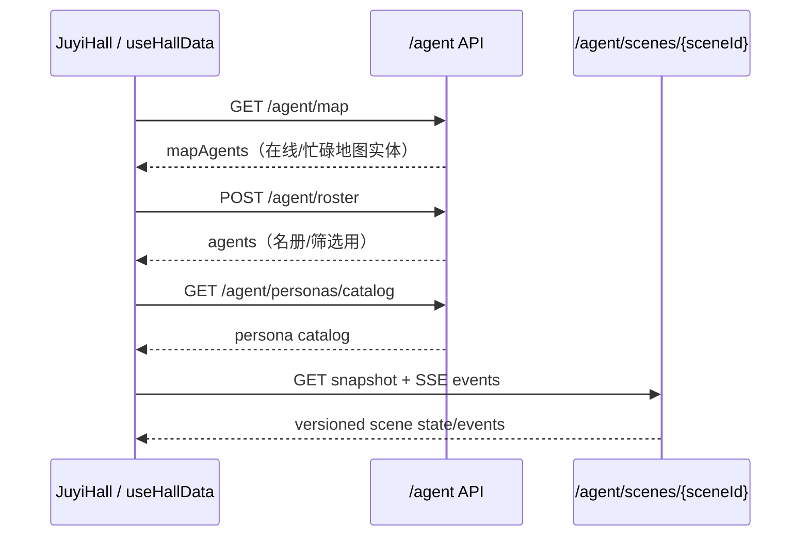

# 聚义厅端到端链路

> 有效性：原有链路章节来自 `BASELINE.yaml` 的 2026-08-15 静态基线及既有增补，本轮未全量复核。仅“议事输入区 UI”按明确源码范围更新；历史发布证据不等于当前线上状态。

## 页面组合

`JuyiHall.vue` 将 `HallStage`（场景）与 Agent、榜单、人格目录、公共/悬赏/私聊讨论、资料库等浮层面板组合。选择 Agent/任务是显式响应式状态；面板打开时锁定场景交互，并包含焦点管理。

## Agent 数据流

`useHallData` 只以 `/agent/map` 填充地图可见 Agent，以 `/agent/roster` 填充名册 Agent；不要使用 `/agent/active` 将两条流重新合并。场景快照和事件通过规范化 scene version 拒绝倒退或重复事件。

## 悬赏任务流

- 读取：`POST /agent/tasks/search`、`POST /agent/tasks/status-counts`。
- 创建：`POST /agent/tasks`。
- 指派：`POST /agent/tasks/{taskId}/assign`，客户端载荷显式携带 `agentId` 与 `agentIds`。
- 推荐/自动指派/归档：分别为 `recommend`、`auto-assign`、`archive` 子资源。
- 客户端对业务结果码做二次判断；成功后局部更新任务和 Agent 状态，再由刷新校正。

Agent schema 中的 `agent_task_meta`、`agent_task_member`、`agent_task_work_item`、`agent_task_request`、`agent_task_artifact`、`agent_task_note` 是该协作域的持久化线索。协作迁移加入 mode、risk、max agents、coordinator、review required 与 aggregate/event version 等字段。

## 对话和事件流

`useHallConversation` 通过 `POST /chat/stream` 发送内容，并通过 `GET /chat/conversation/events?id=...` 消费 SSE。Chat 后端同时有 conversation list/content/update/delete、library search/documents，以及任务团队线程接口。后端 Chat 服务使用流式 AI 响应、会话持久化和聚义厅 scope；客户端处理 event payload、增量消息、流终止和恢复状态。

后端场景流由 `GET /agent/scenes/{sceneId}/events` 提供 SSE；支持 `sinceVersion` 和 `Last-Event-ID` 取较大游标恢复，SSE event id 为 scene version。`POST /agent/scenes/{sceneId}/phases` 上报 arrived/blocked 等阶段，并校验 report、agent、region、phase、state version 与时间。

### 当前会话发送契约（2026-10-09 局部核对）

核对 Web `e3afb42dc69272f43699c2c423b06da7539f0671` 的会话发送、取消接线和回归；API `1e9111028fbdff1ae5452f64aec843e85e81ad59` 仅只读核对 ChatController capabilities 与 relay durable admission，本轮未改后端。其余章节保留原基线，不推断当前线上版本。

发送入口局部补充核对（2026-10-09，Web `74dffae9379c8259283aa653304484981a66ace7`）：文本只在 `sendHallMessage` 规范化一次，再将同一内容传入内部发送函数；同步忙碌判定复用 `isConversationBusy`，保留发送锁、语音字符串/CAS要求和能力检查后的身份隔离。下面其余协议行为仍沿用已核对的 e3afb42 基线，未改变契约。面板输入/事件去重的行为回归见 `juyiting-discussion-panel-bindings.test.js`；交付边界见 [本轮handoff](../implementation/handoffs/HALL-LIGHTWEIGHT-P1-20261009.md)。

- 首次发送要求 `/chat/capabilities` 声明当前 schema2 durable 契约；失败/不支持时不 POST、不插入乐观消息、不清草稿及引用，明确提示消息未发送，下次可重新检查。不保留旧 payload 回退。
- `/chat/stream` 仍为当前入口。每次有效发送在异步检查前锁定唯一 requestId，body 与 `Idempotency-Key` 一致，统一发送 revision、interactionHint、clientSeenVector、inputRefs。metadata 白名单、身份/作用域隔离不删。
- 取消仅使用已知 durable turn（含版本条件）或 allPending 请求；页面和三个议事面板不再暴露旧传输停止按钮。身份切换/卸载的本地流清理、语音停止等待仍是不同语义。
- POST 结果未知只 GET 原 request，不重新 POST；无 conversationId 也保持未确认请求锁。既有2秒消息轮询先核对原请求状态，再读取同会话历史；单个最终消息不代表全部子回话结束。异步返回须仍属当前身份/作用域/请求。
- 文本流、SSE游标、断流恢复仍在使用，不能按“legacy”注释整体删除。最短诊断入口为 `juyiting-codex-fast-deliberation`、`juyiting-hall-conversation`、`juyiting-component-behavior`、`juyiting-voice-conversation`；正式证据和范围见 [本轮handoff](../implementation/handoffs/HALL-PROTOCOL-CONVERGENCE-20261009.md)，源码收敛不等于上线。

## 变更不变量

1. 保持 map 与 roster 两种 Agent 语义分离。
2. 分配动作必须以函数参数/请求体中的目标 Agent 为准。
3. 检查 scene version、SSE 断线恢复与 feature flag 降级路径。
4. 角色显示改动应先查角色 resolver 与 constants，不在 Token/Panel 组件重复写规则。
5. 聚义厅行为改动至少选择相关 `web/tests/`，并让精确远端提交在前端 Flow CI-only 通道执行定向测试和生产构建；本地脚本仅辅助诊断。

## 议事输入区 UI（2026-10-08 局部收口）

### 来源与范围

- 源码核对：Web `75766a3b78c2e552ef448e924a813ed2dfc7ecd4` 的 `ChatPanel.vue`、`HallChatComposer.vue`，并与发布提交 `ee6ca1b6beba562e0c7fa13d422857f554644471` 对比。核对的是本地 Git 对象，不是新发布或实时线上复验。
- 历史交付：前端 1.0.6 / Flow 4403172 Run180 的 UI-only 发布；[版本记录](../../specs/juyiting-ui-baseline-20261006/release-1.0.6.md)及其 release、artifact、online、browser JSON 对应版本/commit/Run 一致。本次只读取记录，不重复运行所记测试。
- 局部 UI 已交付不代表整套业务验收完成；原记录的 R01、重复正文、完成态恢复待办不在本次重新判定。后续源码的局部修复也不自动证明整个待办已关闭。

### 稳定行为与边界

1. 话头工具栏承载重取回话、话头记录、另起话头；这些入口仍向上传递各自事件，不因图标化合并业务语义。
2. 输入区保留“更多、添加资料、语音、发送”；资料可直接打开，不需要先打开更多菜单。资料区域使用独立 materials 插槽，菜单收起不等于资料选择器隐藏。
3. 更多菜单展示语音设置；`moreOpen || voiceHasDetail` 保证非空闲语音反馈不只依赖菜单打开。保留处理状态、取消、错误和输入禁用语义，不为界面简化移除反馈。
4. 空闲图标采用 20px SVG、1.8px 描边、38px 点击区；图标按钮保留可访问名称。三种议事复用面板/输入组合，不另建一套纯外观业务分支。
5. **后续源码边界（非 1.0.6 新增）**：`bounty` 且服务端任务状态为 `completed` 时，ChatPanel 锁定输入/相关动作并关闭资料选择器；身份、任务或会话切换也重置资料选择状态。UI 外观修改不能删掉这些保护；本文不将客户端禁用等同于服务端授权检查。

### 2026-10-09 局部轻量化补充

核对 Web `3e9b0aff365c25faab524e905b7c2f1aff53c3f1` 的输入区与相关回归差异，其余内容仍按上方旧基线理解。只去掉重复的源码写法断言，不删除资料绑定/隔离检查；资料按钮、百宝箱跳转、工具栏位置与语音反馈改由现有挂载组件测试验证真实行为。新增三种议事目标/移除权限、名单外目标不展示、各类输入锁和草稿保持回归。非空闲语音反馈由既有 `voiceHasDetail` 控制显示，不再要求无样式作用的状态 class 存在。此为源码整理，不是业务协议切换或生产发布。

### 后续改动的最短验证路径

- 先查 `web/tests/juyiting-composer-more-menu.test.js`、`web/tests/juyiting-voice-conversation.test.js` 及目标行为相关用例；保留真实事件、可访问名称、禁用状态和资料入口断言，不只匹配可见文案。
- 布局诊断覆盖桌面、手机与窄屏，资料直接打开、更多关闭、语音进行中、任务完成和上下文切换；历史 1440/390/320 记录是复测参考，不是新候选已通过证据。
- 前端正式验证仍使用 Flow 的精确候选；本地仅开发预览/低成本诊断，不本机生产构建。UI 与真实发送、录音、Provider 调用和完整任务交付验收分开。

组件职责见 [前端架构](05-frontend-architecture.md#hall-discussion-composition)；原型、实施经过与原发布证据只在 [历史来源导航](../../specs/juyiting-ui-baseline-20261006/README.md)按需追溯，不作为日常开发必读。

## 控制回执与普通取消页面（2026-10-10 局部源码收口）

### Runtime presence回执

核对Runtime源码 `aa6b96aa983f47b4a4d8daff64eaf717b5781978`，仅execution-adapter控制回执路由及其回归；不是本版本线上安装声明。API `AgentWebSocketHandler.updateAgentStatus` 发出的 `agent_status_updated` 是不带messageType的presence控制回执，不应交给业务消息必填字段解析器。

- 原adapter在socket/会话边界后精确识别并消费此回执，不授予ready、不修改生命周期、不重新注册。任何显式业务messageType不因外层控制type而被吞掉；注册ACK及关联错误仍受原关联/会话核验，未知事件保留业务拒绝。
- 这修复了一条可复现的`MESSAGE_TYPE_REQUIRED`来源，不证明全部线上同码日志都是presence；上线后须另核实际安装版本及新日志。
- 定向和受影响回归、源码与集成证据见 `/home/isp/wsps/cyf/docs/implementation/handoffs/JUYITING-FLOW-GAPS-20261010.md`。未改变全局normalizer、未恢复旧版本兼容。

### 普通取消与除名前告知

核对Web源码 `41a3e343e39ba5d0e41dbbcd7689f854caf17834`，仅相关页面/取消helper与测试；本地定向诊断不是正式Flow或线上验收。

- 事项详情可调用已有 `POST /agent/tasks/{taskId}/cancel`；JSON仅整数expectedTaskVersion，面向无资金事实、未实际开始的open/planning/assigned，服务端为最终裁定。资金任务保持原funding/cancel，不绕资金结算。未知结果先GET原事项，不自动重发POST；拒绝和刷新待完成不伪报为全部刷新成功。
- cancelled显示“已取消”，禁止继续办理，保留历史指派及只读成果；completed/accepted保留原验收回执视图。取消请求守卫身份/授权代次、任务与面板生命周期，不能把已取消历史指派当作新执行权限。
- 除名前须确认：旧租约不会自动转移至新绑定，重新入伙可能重新报价收费；此操作不退款或迁移租约。仅接应故障时优先核对原租约和可用免费重整；没有租约读回证据时不暗示“无成本”。取消弹窗不发送DELETE。
- 本次未增加运行中任务强停、退款、赠款、跨租户上线或native除名生命周期回收；详见上述handoff的测试/发布边界。

### 2026-10-11 局部发布核对

Web1.14.4（commit `759b150a4b96ba9ba9cdb46ee1c2d290bb63dc91`，此前41a3e34业务实现不变，仅版本/fixture收口）经Flow4403172/195正式测试、构建、同Run部署并核对线上文件；Runtime `aa6b96aa983f47b4a4d8daff64eaf717b5781978` 经原installer产物发布到唯一共享Runtime，原4主体与托管状态保留。详细回执在上述handoff，不把本次局部发布升级为整套流程/Provider推理验收。

Runtime的presence回执已在线正常消费，但仍有其他协议拒绝待逐帧归因。outer-frame代次不匹配此前静默拒绝，本次新增可见日志，不能仅比较日志数量断言新增拒绝；也不能凭服务运行/短窗口无MESSAGE_TYPE_REQUIRED认定所有控制帧问题消失。正常回执消费不授予readiness；实际托管READY依旧来自当前会话的原注册、executor、durable proof。历史RECOVERY_REQUIRED文件保持，不自动重放或清除。

本轮真实页面只覆盖已取消事项详情/只读历史与除名前确认后取消（不执行DELETE）。首页概览“最近事项”的取消状态文案仍为“状态待核对”，不能据详情修复宣称所有摘要卡片均已统一；取消详情的辅助推荐POST尝试亦未做真实服务端验证。遗留与证据见handoff，不混入已完成口径。

### 五项页面修复：源码与线上分开（2026-10-11）

源码核对 Web `a63ee17c23061775821c74784bf949271e645ad3` / tree `a992988c8e9e377dcef1926685350ecf05a34137`，覆盖HallOverview、BountyPanel、BountyAcceptancePanel/BountyExecutionOutputs、JuyiHall终态历史接线和相关成果composable。上段1.14.4线上遗留是发布时事实；本节只记录新源码，不表示已替换线上版本。

- 概览正式事项的cancelled显示“已取消”；failed为“失败”，blocked为“受阻”，不把失败与阻塞混用，不改私人事项大写状态含义。
- 普通取消先使用既有Dialog确认原事项；冻结task/version/身份上下文，关闭或放弃不提交，身份/事项/版本/可取消条件变化使确认失效。既有取消client继续负责幂等、防重、未知结果只GET核对，不新增取消API或扩大已开工取消能力。
- 原验收来源索引和成果组件各有一条无条件2500ms轮询。现按真实请求、turn/EXECUTE和已验证typed动作是否仍在进行决定刷新；完成/只读取消终态不再后台反复扫描。身份/面板/任务切换或卸载终止旧请求并保留代次防护，人工重读和版本变化可重新读取，不以首次看到文本冒充执行已完成。
- 取消、确认验收和继续修改按钮采用既有聚义厅配色，补齐圆角、44px触控高度、hover/focus-visible/disabled样式。已有验收条件、服务端授权与成果保存非前置语义不变。
- 原Owner定向613 PASS及本地实际Vue/Varlet浏览器15项检查（含稳定弹窗/390px屏宽）通过；合成API/身份不是生产业务验收。正式Flow与是否发布查看现行handoff `JYT-UI-FIVE-FIXES-20261011` 段，不能据此宣称五项线上已修好。

本候选正式验证补记（2026-10-11 09:37）：Flow4403172/196以同a63ee17源码完成测试2887 PASS/2 pending/0 FAIL、扫描和构建，364制品文件摘要核对通过；**CI-only、未部署**。当前线上基线仍为此前Run195，不把源码/CI通过重标为线上修复。

## 通用技能与图片交付：现行实现（2026-10-16）

**覆盖与固定源码**：API `6116a10403e0df250850e6ebb73f8123f5ac9ded`、Web `421f628c245b83466cafb70510ff69188180bdee`、Runtime `6a9d8d3c1219450c19b3edfbef317e615940ab5d`；对应2026-10-15发布1.16.5/1.16.1/1.2.7。本节是局部现状，不更新2026-08-15全库静态基线，不代表所有技能/接口均线上验收。

### 组成与调用链

1. Web办事页关联固定图片资料版本；会话发送DISCUSSION，API冻结任务、assignment、授权资料sources和可用actions。模型原生图片载体可用于直接回答，不强制为了“识别”新增一个独立业务任务。
2. API的`ChatActionCapabilityService`按实际安装权益、manifest、当前认证Runtime目录和任务授权计算可调用动作。安装成功不等于可调用；断线、代际/摘要不符不得保持旧READY。吴用image-edit使用现有`provider-operation`，输入资料1张，输出PNG。
3. Runtime按冻结actions构造原生输出schema及digest；模型只能ANSWER、CLARIFY或请求其中的动作，不能凭文字创造执行权限。无动作时`action:null`。action含`actionId`、`instruction`、`sourceRefIds`、`parameters`。
4. API接纳动作并沿现有执行链派发，Runtime通过runner/完整主体Provider binding处理。费用只登记，不新增平台执行费用审批；技能包购买事务与实际Provider计费各自独立。
5. Provider产物按现有执行结果合同归档，`RESULT_COMMITTED`/`COMPLETE`后从execution定向结果读取outputs。Web渲染文件/图片卡片及鉴权下载；保存到工作空间不是下载或验收前置。消息文本不能冒充实际产物。

### 协议与权限的代码边界

- 公共规范唯一来源为[接口规范1.2](../../api/docs/interface-standard.md)，字段详设/逐接口声明在[接口目录](../../api/docs/interface-catalog/README.md)。第三方微信、GitHub/OAuth回调遵循提供方协议，不套本站信封或JWT。
- `AgentWebSocketHandler`先把认证`Receipt`显式投影为字段Map，再由`AgentMessageWire`映射`runtimeInstallationId`与十进制字符串`sessionGeneration`。Runtime`SkillRegistry.setSession`严格接收规范正int64字符串，不转JS Number。
- `agent-client.mjs`的持久消息版本校验区分SQL版本与技能语义版本：仅声明的`factsManifest/contextSnapshot.facts → typedDeliberation.availableActions[].skill.skillVersion`是技能版本，其他代际/修订/fence仍严格校验。
- `ChatCancelDTO.expectedStateVersion`为可选字符串，`ChatController`严格解析规范非负int64再交给现有Long CAS；缺省语义保留，不开启全局类型强转。
- 仅取消“任务方与Agent必须同Owner”资格限制。登录认证、任务委派/grant、资料版本ACL、安装管理权限、Runtime身份/session fence、事务和幂等全部保留；这不是新增外单业务功能。

### 扩展边界与已知限制

- 同runner的新技能由包manifest/参数/输入输出与绑定声明接入，不按图片/PDF/Excel/视频在任务核心中各建专用执行系统。新增runner或新能力仍须实现其适配和回归；本次没有实际证明所有媒体技能可用。
- 原生模型schema投影目前是保守子集：封闭对象、全部属性required；不支持可选/开放对象/`$ref`等时明确`ACTION_MODEL_SCHEMA_UNSUPPORTED`，不能静默删参数、填默认值或宣称完整Draft2020-12支持。image-edit的空封闭参数对象已实际执行。
- 当前验收：上传、形状/颜色/位置识别、蓝三角改黄、归档及真实下载通过；黑色像素字体Q7Z5两次识别为0725，**全文字识别验收失败，总体PARTIAL**。生成图放大且有轻微纹理，不承诺像素级无损修改。
- 运行排障/配置/发布入口见[现行runbook](../juyiting-runbook.md)；原合同和逐项结果见[特性验收](../../specs/juyiting-skill-execution/acceptance.md)。临时执行器不作为长期发布入口；原始制品、失败回执、输入/输出摘要继续保留，不能清理成“全部成功”。

### 图片技能与空取消历史的现行边界（2026-10-25局部核验）

源码范围：API e7e6f7e3、Web075c0c28、Runtime c4688cf7；仅覆盖技能管理、模型schema适配与媒体续聊，不重标本章其余旧基线。

- 技能管理SM-C1使用已认证Native WebSocket；执行HTTP pull是另一条链。管理恢复以当前唯一session/身份/fence及durable健康为准，不依赖待恢复的执行能力目录AVAILABLE；真正执行仍检查技能权益、绑定及目录准入。
- image-generate/image-edit 1.2.0可选size；精确尺寸在图片runner做等比缩放与透明留边，保留Provider原成果，恢复不重复调用Provider。没有要求时可省略，不按文件格式扩充议事主流程。
- 模型严格schema是原manifest的适配投影：可选参数可用nullable表达省略，只有原本不允许null的可选字段才把模型null还原为省略；原允许null保留null。Provider投影可省略不兼容pattern，但返回值须按原manifest完整校验后形成正式摘要，不取消未知执行语义/权限/完整性保护。
- 服务端目录确认CANCELLED、所有非空turns均取消且lastDeltaSeq=0/finalMessageId=null/steps=[]、无已有READY成果的历史回合，不是未读取成果，不得冻结后续识图/改图。未知、部分输出、final消息或执行步骤不适用。不删历史、不自动重发。实现与关键回归见Web useHallTypedDeliberation.js及juyiting-media-delivery-basis.test.js。
- 线上任务526已验证800×600生图、识图、改图、再次识图、PC/手机预览及选择新版验收，文件摘要与ACCEPTED正式交付一致。**在途Runtime/后端故障注入恢复未验**，不与主流程通过混淆。完整证据及异常回溯见既有BRANCH-RELEASE-REVIEW-20261024 handoff末节与position-only-integration-20261025/image-size-management-followup.json。
