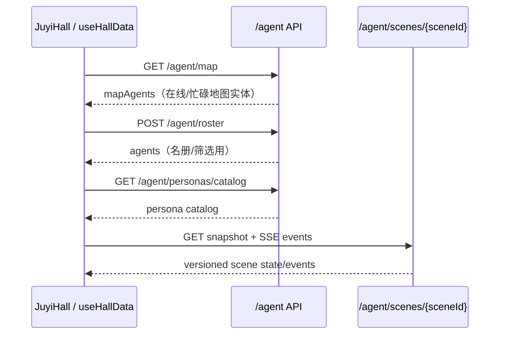

# 聚义厅端到端链路

> 有效性：原有链路章节来自 `BASELINE.yaml` 的 2026-08-15 静态基线及既有增补，本轮未全量复核。仅“议事输入区 UI”按明确源码范围更新；历史发布证据不等于当前线上状态。

## 内测事项费用（源码已集成，尚未生产切换）

2026-11-06局部核对：API `f24f4c1aef16c4eb48b95329b828cc83ec2f1558`、Web `c1e478f633845a448833a3973e732a12a75874aa`、Runtime `dbb9e3d93466460235ace9e926a4b63627bb4377`。只说明下列已实现职责，不将旧章节的银两/固定预览价作为新业务规则；不证明这些版本已安装，也不改变全文旧基线。

### 两本账及责任层

- **用户钱包：整数文。** 1元=100文；事项报价为预估人民币总额×100后向上取整，费用方案/版本/工作量与承办绑定形成不可变报价。缺所需价格或估算规则时该候选不可报价，不默认0元。
- **业务事务：事项服务持有状态与权限。** 推荐/选择候选不扣费；明确确认承办时由真实事项根事务调用`TaskBillingServiceImpl.reserve`，派单与预占共同提交或回滚。验收扣除原预占报价、取消释放；未验收一直预占。`TaskBillingServiceImpl`要求加入调用方事务，不调用模型、网络或Runtime。
- **平台成本：人民币六位。** `UsageCostServiceImpl`以独立短事务保存调用证据、价格快照、不可变修订及汇总差额；状态为`PRICED/PENDING_USAGE/PENDING_PRICE`，未知不是免费。成本回执迟到不再次动钱包，不要求等成本齐全才验收，不按每个Token写库或在请求中全表重算。
- **来源与授权不能互换。** 推荐直接响应、普通CHAT、原生执行沿各自可信调用/持久投递边界接成本账；业务完成ACK不等于费用ACK。原生`last/total`与付费工具缺少已核实计费语义的证据仍待核对，不能用模型可改文件或stdout作为财务凭证。

### 入口与配置

- 钱袋`/wallet`显示余额与流水；API为`GET /economy/wallet`、`GET /economy/ledger`、`POST /economy/events`，沿统一认证/环境scope及Q/R。钱袋余额节点不在`/juyiting`页面，浏览器验证须区分两个路由。
- 聚义厅`HALL_ENTERED`触发可配置活动；候选配置`beta-hall-welcome-v1`赠3500文且默认关闭。同活动领取幂等，停活动不清领取事实；不是按注册日赠送，也不是普通埋点任意增余额。
- `economy.pricing.models/tools/rules`保存人工人民币价与估算规则，不引入在线汇率。没有合法目录不会猜价；模型展示与计费路由是不同责任，不能从好汉详情展示文字推断采购渠道。
- 好汉详情展示Runtime上报的执行模型；统一目标`gpt-6-luna`不意味着本任务已修改生产配置或将历史模型改名。

### 验证与切换边界

固定产品源码已通过API584（含实际JWT/Tomcat/MySQL的承办、验收、取消）、Web470、Runtime165回归；测试证据见[当前handoff](../implementation/handoffs/BETA-WEN-BILLING-20261105.md)。2026-11-07补充源码API `a6eee0d2680a98b6b4d84d796571156c5cb68be7`（starter1.1.40）及Web `b1c97e2ba909f08cda36eba8b7246027b30cfbeb`（1.16.124）已合入各自develop；两端本地包成功。新Web生产制品接真实JWT/Tomcat/MySQL通过承办预占/余额不足及独立SQL断言；fixture等待新手引导关闭且导航不再inert，390截图不再受引导遮挡，1440/390无横向溢出。非资金资料/目录仍是明确fixture，无Provider执行；不是线上验收。API本次两browser与layering新执行，86项SQL/授权/正式交付及未变schema/hosting输入按固定来源复用，详见`api-retained-a6eee0d2-result.json`，不将旧JUnit冒充fresh。

旧经济表含技能权益和非零托管租期，不可整体清空或把微银两列直接重命名为文。活动启用、生产价格/模型配置、旧资金重置、托管权益保留和安装分别按授权执行；本节不是迁移脚本或发布批准。冻结要求、待确认事项及回归入口见[内测费用方案](../../specs/agent-economy-marketplace/beta-wen-billing.md)。

## 图片子调用实际成本（2026-11-08定向核验）

范围：API `e229e5280628c826469a93c71901523adb46f75b` / Runtime `5dc596c9721000bcbca3c9dcb38d7b8e1c8d3a1e`，分别1.1.43-SNAPSHOT/1.3.67，图片生成与编辑技能1.3.2已上线；不重标本页其他旧基线。

- 图片helper每次HTTP调用保存独立STARTED/TERMINAL回执；JSON中的usage在图片校验/缩放前保存。Runtime按原执行绑定持久化并补投，业务成果ACK不消耗费用ACK；API验原执行归属，economy按幂等调用ID规范化并记实际人民币成本，不改变事项报价/预占/验收扣文。
- 文本、缓存文本、图片输入、缓存图片、图片输出分别计价，不重复统计缓存。`gpt-image-2.5-flare`统一标准价，精确channel/tier/priceVersion随安装配置传递，调用开始快照固定价格；缺usage/缺价留PENDING，不记免费或再生成图片补账。
- 单价按手动人民币/百万Token登记；显示单位仍文，实际成本记账人民币6位。具体价目和协议见[现行费用合同](../../specs/agent-economy-marketplace/beta-wen-billing.md#图片provider子调用成本2026-11-08实施合同)。没有运行时外汇转换，也不把渠道返回usage核算额当已对账发票。
- 本批没有付费生图。正式回归及实际安装helper→bridge的合成回执验收通过；自然业务渠道的usage形状仍需观察。升级通过正式岗位发布与技能变更接口，不直接覆盖已安装包；新安装ID须在既有private configuration中继承原凭据/网络来源及精确价目版本。

## 议事与成果展示（2026-11-03定向核验）

核对Web `5efec28e32da04094c4d22d52994194e33bdfe48`（1.16.99 / Flow417）；仅下列展示行为，不重标全文旧基线。

- 事项议事中的执行控制文字按服务端typed ACTION_REQUEST及精确关联隐藏，不按自然语言猜测；未分类流片段等待类型确认，普通答复/追问保留，私聊流式不变。
- 父CHAT结束不等于子EXECUTE成果完成；去掉事项冗余成功页尾，保留权威执行状态和真实失败/取消，不修改持久化原文或API完成事实。
- HTML/Markdown成果复用认证读取和沙箱文档预览，禁止脚本、外链跳转和外部资源；图片展示和成果文件自身质量分开判断。
- 专用事项真实浏览器验证了HTML初稿→修改→新版预览→选择新版验收→完成后重开，以及蓝鸟生成→改红鸟→双图预览、正常问答。受测图片原文件黑条、HTML内容细节一致性仍属生成质量问题，不计入功能全通过。测试/安装/线上证据和覆盖限制见 `docs/implementation/handoffs/DISCUSSION-RETEST-20261102.md` 18:16节。

## 成果读取改为事件驱动（2026-11-04 局部源码核对，未部署）

范围：Web `07ae312741173a2d181c548a6605bed544237641`（1.16.104），Flow4403172/434测试、构建与制品核验通过；本节描述源码行为，不代表当前线上收益，不更新其他章节基线。

- 成果组件、技能结果和验收索引移除各自2500ms周期查询。成果随既有权威catalog/request变化读取；验收以初读、实时事件、前台恢复及显式刷新读取，不引入全局缓存、服务端扫描或新服务。
- 验收与聊天同会话时共享既有认证SSE，包括聊天断线重连期间；独立进入验收且没有聊天连接所有者时，才建立验收专用认证SSE。历史回放不逐条查索引，stream_ready后补读当前索引；preview/heartbeat不触发成果查询。
- 权威成果/失败/受理/resync等事件触发索引刷新；读取期间的事件合并为尾随读取。仅真实断流后退避重连，不以定时器空查索引；断线保留已核实成果，恢复后同值结果不重读正文。
- 完成事项停止实时订阅，取消事项历史保持只读；身份、事项、可见性及销毁时取消相关连接/请求。保留下载授权及摘要核验，手动读取仍可用。
- 聊天与验收仍各有自己的索引投影，不能声称全页面每个事件仅一次HTTP。本批未改变API/Runtime/模型，线上CPU/SQL和首字性能仍需部署后实测。固定源码、测试及制品证据见[现有handoff](../implementation/handoffs/JUYITING-POLLING-20261102.md)。

上线补充（2026-11-04）：上述改动已包含于后继Web `320d76f19c72b80d34c668be6f6b6e3bdb12363f`（1.16.105 / Flow435），由事项编辑发布任务安装，本任务独立核验612安装文件及11项公网资源一致。真实登录后既有事项议事/成果可见，60秒可见空闲窗口无新增HTTP响应；不作为前后收益对比，也不代替独立验收实时事件/断线回补和首字延迟实测。来源、覆盖限制及自然负载样本见同一handoff的10:58节。上文07ae312/434仍是开发验证基线，非本次实际安装来源。

## 托管与统一调度责任（2026-11-11源码复核，未上线）

仅核对API候选 `ed5010e882450222eb59814a68a16a4f9dc04b68` 的托管/调度责任，不重标上文历史发布状态。

- 托管开通使用租费业务入口与Runtime受控通道；旧API直接写profile的开通状态机、publisher及无调用的写DAO/Mapper已删除。原历史表/实体只读保留，当前Runtime投影提交后通知仍保留；自行部署引导不能视为50文租费已接入。
- 资金、关系权限与同库事务由API负责；同一事务已经锁定并核验的绑定不额外重复读取。外部Runtime I/O后的关联重验仍必要，不能按“去重”删除；Runtime负责本机停机、公共数据保留与私有数据清理，不复制API扣费状态机。
- 统一task负责持久待办、期限唤醒和恢复；租期/资金事实由费用消费者负责。旧事项执行不重复加租费派发门禁；新承办、密议与技能操作使用各自业务准入。源码与分批测试不等于生产启用，当前验收及剩余项见[调度验收](../../specs/task-scheduling/acceptance.md)。

## 页面组合

`JuyiHall.vue` 将 `HallStage`（场景）与 Agent、榜单、人格目录、公共/悬赏/私聊讨论、资料库等浮层面板组合。选择 Agent/任务是显式响应式状态；面板打开时锁定场景交互，并包含焦点管理。

## Agent 数据流

`useHallData` 只以 `/agent/map` 填充地图可见 Agent，以 `/agent/roster` 填充名册 Agent；不要使用 `/agent/active` 将两条流重新合并。场景快照和事件通过规范化 scene version 拒绝倒退或重复事件。

## 悬赏任务流

- 读取：`POST /agent/tasks/search`、`POST /agent/tasks/status-counts`。
- 创建：`POST /agent/tasks`。
- 指派：`POST /agent/tasks/{taskId}/assign`，客户端载荷显式携带 `agentId` 与 `agentIds`。
- 推荐/自动指派/归档：分别为 `recommend`、`auto-assign`、`archive` 子资源。
- 客户端对业务结果码做二次判断；成功后局部更新任务和 Agent 状态，再由刷新校正。

Agent schema 中的 `agent_task_meta`、`agent_task_member`、`agent_task_work_item`、`agent_task_request`、`agent_task_artifact`、`agent_task_note` 是该协作域的持久化线索。协作迁移加入 mode、risk、max agents、coordinator、review required 与 aggregate/event version 等字段。

## 对话和事件流

> 局部核对（2026-10-20）：API `9ca2776c27ce3270efa0ea4c366b7de0e68e8dbb`、Web `f08e427f56f9172068b697eae13dcdbfd0076f9c`，仅下述持久SSE/重连部分；其余段落保留原核对基线。认证conversation/events的持久回放与catch-up遵循下游背压，不可再在整体流上套急切的64条`onBackpressureBuffer(ERROR)`，否则历史回放会先灌满队列。broker的有界live提示及持久序列补齐、身份/世代/cursor/取消清理仍保留。前端复用原重连计时器与single-flight权威request读回，缺持久final才取原会话历史；不自动重发、不把网络失败等同执行失败。正文恢复不等于成果目录/验收资格恢复；混合读取和投影修复见下述Web1.16.24局部核对，其他范围不重标。

> 投影恢复局部核对（2026-10-20）：Web `50107f38a757a5ce58d298965a953a353d7b48b1` / 1.16.24 / Flow257，API沿用195。原议事续发/恢复先读取权威TaskDTO，再校验同身份/事项/话头/目标的指派上下文；合法事项版本不倒退，不能把任务列表选择当会话主体。SSE正常不代表目录或typed-outcome GET成功：失败读保留待恢复标记，经现有重连计时槽及single-flight补读，成功清除；无新增监听或自动POST。验收预览按artifactId/version/hash匹配，旧缓存未命中时只刷新一次，异步迟到结果按身份/事项/点击代次隔离，不换成旧成果。已核验PC及390×844移动视口的文字主流程、连续修订、GET-only受控传输故障恢复和显式验收；不宣称自然断网、所有媒体/多Agent/付费分支通过。证据：`specs/juyiting-ui-baseline-20261006/evidence/implementation-20261019/remaining-20261020/web257-projection-dfx-verification.json`。

`useHallConversation` 通过 `POST /chat/stream` 发送内容，并通过 `GET /chat/conversation/events?id=...` 消费 SSE。Chat 后端同时有 conversation list/content/update/delete、library search/documents，以及任务团队线程接口。后端 Chat 服务使用流式 AI 响应、会话持久化和聚义厅 scope；客户端处理 event payload、增量消息、流终止和恢复状态。

后端场景流由 `GET /agent/scenes/{sceneId}/events` 提供 SSE；支持 `sinceVersion` 和 `Last-Event-ID` 取较大游标恢复，SSE event id 为 scene version。`POST /agent/scenes/{sceneId}/phases` 上报 arrived/blocked 等阶段，并校验 report、agent、region、phase、state version 与时间。

### 当前会话发送契约（2026-10-09 局部核对）

核对 Web `e3afb42dc69272f43699c2c423b06da7539f0671` 的会话发送、取消接线和回归；API `1e9111028fbdff1ae5452f64aec843e85e81ad59` 仅只读核对 ChatController capabilities 与 relay durable admission，本轮未改后端。其余章节保留原基线，不推断当前线上版本。

发送入口局部补充核对（2026-10-09，Web `74dffae9379c8259283aa653304484981a66ace7`）：文本只在 `sendHallMessage` 规范化一次，再将同一内容传入内部发送函数；同步忙碌判定复用 `isConversationBusy`，保留发送锁、语音字符串/CAS要求和能力检查后的身份隔离。下面其余协议行为仍沿用已核对的 e3afb42 基线，未改变契约。面板输入/事件去重的行为回归见 `juyiting-discussion-panel-bindings.test.js`；交付边界见 [本轮handoff](../implementation/handoffs/HALL-LIGHTWEIGHT-P1-20261009.md)。

- 首次发送要求 `/chat/capabilities` 声明当前 schema2 durable 契约；失败/不支持时不 POST、不插入乐观消息、不清草稿及引用，明确提示消息未发送，下次可重新检查。不保留旧 payload 回退。
- `/chat/stream` 仍为当前入口。每次有效发送在异步检查前锁定唯一 requestId，body 与 `Idempotency-Key` 一致，统一发送 revision、interactionHint、clientSeenVector、inputRefs。metadata 白名单、身份/作用域隔离不删。
- 取消仅使用已知 durable turn（含版本条件）或 allPending 请求；页面和三个议事面板不再暴露旧传输停止按钮。身份切换/卸载的本地流清理、语音停止等待仍是不同语义。
- POST 结果未知只 GET 原 request，不重新 POST；无 conversationId 也保持未确认请求锁。既有2秒消息轮询先核对原请求状态，再读取同会话历史；单个最终消息不代表全部子回话结束。异步返回须仍属当前身份/作用域/请求。
- 文本流、SSE游标、断流恢复仍在使用，不能按“legacy”注释整体删除。最短诊断入口为 `juyiting-codex-fast-deliberation`、`juyiting-hall-conversation`、`juyiting-component-behavior`、`juyiting-voice-conversation`；正式证据和范围见 [本轮handoff](../implementation/handoffs/HALL-PROTOCOL-CONVERGENCE-20261009.md)，源码收敛不等于上线。

## 变更不变量

1. 保持 map 与 roster 两种 Agent 语义分离。
2. 分配动作必须以函数参数/请求体中的目标 Agent 为准。
3. 检查 scene version、SSE 断线恢复与 feature flag 降级路径。
4. 角色显示改动应先查角色 resolver 与 constants，不在 Token/Panel 组件重复写规则。
5. 聚义厅行为改动至少选择相关 `web/tests/`，并让精确远端提交在前端 Flow CI-only 通道执行定向测试和生产构建；本地脚本仅辅助诊断。

## 议事输入区 UI（2026-10-08 局部收口）

### 来源与范围

- 源码核对：Web `75766a3b78c2e552ef448e924a813ed2dfc7ecd4` 的 `ChatPanel.vue`、`HallChatComposer.vue`，并与发布提交 `ee6ca1b6beba562e0c7fa13d422857f554644471` 对比。核对的是本地 Git 对象，不是新发布或实时线上复验。
- 历史交付：前端 1.0.6 / Flow 4403172 Run180 的 UI-only 发布；[版本记录](../../specs/juyiting-ui-baseline-20261006/release-1.0.6.md)及其 release、artifact、online、browser JSON 对应版本/commit/Run 一致。本次只读取记录，不重复运行所记测试。
- 局部 UI 已交付不代表整套业务验收完成；原记录的 R01、重复正文、完成态恢复待办不在本次重新判定。后续源码的局部修复也不自动证明整个待办已关闭。

### 稳定行为与边界

1. 话头工具栏承载重取回话、话头记录、另起话头；这些入口仍向上传递各自事件，不因图标化合并业务语义。
2. 输入区保留“更多、添加资料、语音、发送”；资料可直接打开，不需要先打开更多菜单。资料区域使用独立 materials 插槽，菜单收起不等于资料选择器隐藏。
3. 更多菜单展示语音设置；`moreOpen || voiceHasDetail` 保证非空闲语音反馈不只依赖菜单打开。保留处理状态、取消、错误和输入禁用语义，不为界面简化移除反馈。
4. 空闲图标采用 20px SVG、1.8px 描边、38px 点击区；图标按钮保留可访问名称。三种议事复用面板/输入组合，不另建一套纯外观业务分支。
5. **后续源码边界（非 1.0.6 新增）**：`bounty` 且服务端任务状态为 `completed` 时，ChatPanel 锁定输入/相关动作并关闭资料选择器；身份、任务或会话切换也重置资料选择状态。UI 外观修改不能删掉这些保护；本文不将客户端禁用等同于服务端授权检查。

### 2026-10-09 局部轻量化补充

核对 Web `3e9b0aff365c25faab524e905b7c2f1aff53c3f1` 的输入区与相关回归差异，其余内容仍按上方旧基线理解。只去掉重复的源码写法断言，不删除资料绑定/隔离检查；资料按钮、百宝箱跳转、工具栏位置与语音反馈改由现有挂载组件测试验证真实行为。新增三种议事目标/移除权限、名单外目标不展示、各类输入锁和草稿保持回归。非空闲语音反馈由既有 `voiceHasDetail` 控制显示，不再要求无样式作用的状态 class 存在。此为源码整理，不是业务协议切换或生产发布。

### 后续改动的最短验证路径

- 先查 `web/tests/juyiting-composer-more-menu.test.js`、`web/tests/juyiting-voice-conversation.test.js` 及目标行为相关用例；保留真实事件、可访问名称、禁用状态和资料入口断言，不只匹配可见文案。
- 布局诊断覆盖桌面、手机与窄屏，资料直接打开、更多关闭、语音进行中、任务完成和上下文切换；历史 1440/390/320 记录是复测参考，不是新候选已通过证据。
- 前端正式验证仍使用 Flow 的精确候选；本地仅开发预览/低成本诊断，不本机生产构建。UI 与真实发送、录音、Provider 调用和完整任务交付验收分开。

组件职责见 [前端架构](05-frontend-architecture.md#hall-discussion-composition)；原型、实施经过与原发布证据只在 [历史来源导航](../../specs/juyiting-ui-baseline-20261006/README.md)按需追溯，不作为日常开发必读。

## 控制回执与普通取消页面（2026-10-10 局部源码收口）

### Runtime presence回执

核对Runtime源码 `aa6b96aa983f47b4a4d8daff64eaf717b5781978`，仅execution-adapter控制回执路由及其回归；不是本版本线上安装声明。API `AgentWebSocketHandler.updateAgentStatus` 发出的 `agent_status_updated` 是不带messageType的presence控制回执，不应交给业务消息必填字段解析器。

- 原adapter在socket/会话边界后精确识别并消费此回执，不授予ready、不修改生命周期、不重新注册。任何显式业务messageType不因外层控制type而被吞掉；注册ACK及关联错误仍受原关联/会话核验，未知事件保留业务拒绝。
- 这修复了一条可复现的`MESSAGE_TYPE_REQUIRED`来源，不证明全部线上同码日志都是presence；上线后须另核实际安装版本及新日志。
- 定向和受影响回归、源码与集成证据见 `/home/isp/wsps/cyf/docs/implementation/handoffs/JUYITING-FLOW-GAPS-20261010.md`。未改变全局normalizer、未恢复旧版本兼容。

### 普通取消与除名前告知

核对Web源码 `41a3e343e39ba5d0e41dbbcd7689f854caf17834`，仅相关页面/取消helper与测试；本地定向诊断不是正式Flow或线上验收。

- 事项详情可调用已有 `POST /agent/tasks/{taskId}/cancel`；JSON仅整数expectedTaskVersion，面向无资金事实、未实际开始的open/planning/assigned，服务端为最终裁定。资金任务保持原funding/cancel，不绕资金结算。未知结果先GET原事项，不自动重发POST；拒绝和刷新待完成不伪报为全部刷新成功。
- cancelled显示“已取消”，禁止继续办理，保留历史指派及只读成果；completed/accepted保留原验收回执视图。取消请求守卫身份/授权代次、任务与面板生命周期，不能把已取消历史指派当作新执行权限。
- 除名前须确认：旧租约不会自动转移至新绑定，重新入伙可能重新报价收费；此操作不退款或迁移租约。仅接应故障时优先核对原租约和可用免费重整；没有租约读回证据时不暗示“无成本”。取消弹窗不发送DELETE。
- 本次未增加运行中任务强停、退款、赠款、跨租户上线或native除名生命周期回收；详见上述handoff的测试/发布边界。

### 2026-10-11 局部发布核对

Web1.14.4（commit `759b150a4b96ba9ba9cdb46ee1c2d290bb63dc91`，此前41a3e34业务实现不变，仅版本/fixture收口）经Flow4403172/195正式测试、构建、同Run部署并核对线上文件；Runtime `aa6b96aa983f47b4a4d8daff64eaf717b5781978` 经原installer产物发布到唯一共享Runtime，原4主体与托管状态保留。详细回执在上述handoff，不把本次局部发布升级为整套流程/Provider推理验收。

Runtime的presence回执已在线正常消费，但仍有其他协议拒绝待逐帧归因。outer-frame代次不匹配此前静默拒绝，本次新增可见日志，不能仅比较日志数量断言新增拒绝；也不能凭服务运行/短窗口无MESSAGE_TYPE_REQUIRED认定所有控制帧问题消失。正常回执消费不授予readiness；实际托管READY依旧来自当前会话的原注册、executor、durable proof。历史RECOVERY_REQUIRED文件保持，不自动重放或清除。

本轮真实页面只覆盖已取消事项详情/只读历史与除名前确认后取消（不执行DELETE）。首页概览“最近事项”的取消状态文案仍为“状态待核对”，不能据详情修复宣称所有摘要卡片均已统一；取消详情的辅助推荐POST尝试亦未做真实服务端验证。遗留与证据见handoff，不混入已完成口径。

### 五项页面修复：源码与线上分开（2026-10-11）

源码核对 Web `a63ee17c23061775821c74784bf949271e645ad3` / tree `a992988c8e9e377dcef1926685350ecf05a34137`，覆盖HallOverview、BountyPanel、BountyAcceptancePanel/BountyExecutionOutputs、JuyiHall终态历史接线和相关成果composable。上段1.14.4线上遗留是发布时事实；本节只记录新源码，不表示已替换线上版本。

- 概览正式事项的cancelled显示“已取消”；failed为“失败”，blocked为“受阻”，不把失败与阻塞混用，不改私人事项大写状态含义。
- 普通取消先使用既有Dialog确认原事项；冻结task/version/身份上下文，关闭或放弃不提交，身份/事项/版本/可取消条件变化使确认失效。既有取消client继续负责幂等、防重、未知结果只GET核对，不新增取消API或扩大已开工取消能力。
- 原验收来源索引和成果组件各有一条无条件2500ms轮询。现按真实请求、turn/EXECUTE和已验证typed动作是否仍在进行决定刷新；完成/只读取消终态不再后台反复扫描。身份/面板/任务切换或卸载终止旧请求并保留代次防护，人工重读和版本变化可重新读取，不以首次看到文本冒充执行已完成。
- 取消、确认验收和继续修改按钮采用既有聚义厅配色，补齐圆角、44px触控高度、hover/focus-visible/disabled样式。已有验收条件、服务端授权与成果保存非前置语义不变。
- 原Owner定向613 PASS及本地实际Vue/Varlet浏览器15项检查（含稳定弹窗/390px屏宽）通过；合成API/身份不是生产业务验收。正式Flow与是否发布查看现行handoff `JYT-UI-FIVE-FIXES-20261011` 段，不能据此宣称五项线上已修好。

本候选正式验证补记（2026-10-11 09:37）：Flow4403172/196以同a63ee17源码完成测试2887 PASS/2 pending/0 FAIL、扫描和构建，364制品文件摘要核对通过；**CI-only、未部署**。当前线上基线仍为此前Run195，不把源码/CI通过重标为线上修复。

## 通用技能与图片交付：现行实现（2026-10-16）

**覆盖与固定源码**：API `6116a10403e0df250850e6ebb73f8123f5ac9ded`、Web `421f628c245b83466cafb70510ff69188180bdee`、Runtime `6a9d8d3c1219450c19b3edfbef317e615940ab5d`；对应2026-10-15发布1.16.5/1.16.1/1.2.7。本节是局部现状，不更新2026-08-15全库静态基线，不代表所有技能/接口均线上验收。

### 组成与调用链

1. Web办事页关联固定图片资料版本；会话发送DISCUSSION，API冻结任务、assignment、授权资料sources和可用actions。模型原生图片载体可用于直接回答，不强制为了“识别”新增一个独立业务任务。
2. API的`ChatActionCapabilityService`按实际安装权益、manifest、当前认证Runtime目录和任务授权计算可调用动作。安装成功不等于可调用；断线、代际/摘要不符不得保持旧READY。吴用image-edit使用现有`provider-operation`，输入资料1张，输出PNG。
3. Runtime按冻结actions构造原生输出schema及digest；模型只能ANSWER、CLARIFY或请求其中的动作，不能凭文字创造执行权限。无动作时`action:null`。action含`actionId`、`instruction`、`sourceRefIds`、`parameters`。
4. API接纳动作并沿现有执行链派发，Runtime通过runner/完整主体Provider binding处理。费用只登记，不新增平台执行费用审批；技能包购买事务与实际Provider计费各自独立。
5. Provider产物按现有执行结果合同归档，`RESULT_COMMITTED`/`COMPLETE`后从execution定向结果读取outputs。Web渲染文件/图片卡片及鉴权下载；保存到工作空间不是下载或验收前置。消息文本不能冒充实际产物。

### 协议与权限的代码边界

- 公共规范唯一来源为[接口规范1.2](../../api/docs/interface-standard.md)，字段详设/逐接口声明在[接口目录](../../api/docs/interface-catalog/README.md)。第三方微信、GitHub/OAuth回调遵循提供方协议，不套本站信封或JWT。
- `AgentWebSocketHandler`先把认证`Receipt`显式投影为字段Map，再由`AgentMessageWire`映射`runtimeInstallationId`与十进制字符串`sessionGeneration`。Runtime`SkillRegistry.setSession`严格接收规范正int64字符串，不转JS Number。
- `agent-client.mjs`的持久消息版本校验区分SQL版本与技能语义版本：仅声明的`factsManifest/contextSnapshot.facts → typedDeliberation.availableActions[].skill.skillVersion`是技能版本，其他代际/修订/fence仍严格校验。
- `ChatCancelDTO.expectedStateVersion`为可选字符串，`ChatController`严格解析规范非负int64再交给现有Long CAS；缺省语义保留，不开启全局类型强转。
- 仅取消“任务方与Agent必须同Owner”资格限制。登录认证、任务委派/grant、资料版本ACL、安装管理权限、Runtime身份/session fence、事务和幂等全部保留；这不是新增外单业务功能。

### 扩展边界与已知限制

- 同runner的新技能由包manifest/参数/输入输出与绑定声明接入，不按图片/PDF/Excel/视频在任务核心中各建专用执行系统。新增runner或新能力仍须实现其适配和回归；本次没有实际证明所有媒体技能可用。
- 原生模型schema投影目前是保守子集：封闭对象、全部属性required；不支持可选/开放对象/`$ref`等时明确`ACTION_MODEL_SCHEMA_UNSUPPORTED`，不能静默删参数、填默认值或宣称完整Draft2020-12支持。image-edit的空封闭参数对象已实际执行。
- 当前验收：上传、形状/颜色/位置识别、蓝三角改黄、归档及真实下载通过；黑色像素字体Q7Z5两次识别为0725，**全文字识别验收失败，总体PARTIAL**。生成图放大且有轻微纹理，不承诺像素级无损修改。
- 运行排障/配置/发布入口见[现行runbook](../juyiting-runbook.md)；原合同和逐项结果见[特性验收](../../specs/juyiting-skill-execution/acceptance.md)。临时执行器不作为长期发布入口；原始制品、失败回执、输入/输出摘要继续保留，不能清理成“全部成功”。

### 技能管理：单列表与当前安装（2026-10-25局部核验）

本节更新技能管理范围：API `347dff304123a031a6d0f5e27d2cb3df58555eaf`（1.17.6/Flow5260799 Run308已安装并线上核验）；Web `075c0c28a7cf7410d915dc15ca5eb5ff50ace01d`（现行Run317，固定源码测试Run318）；Runtime `c4688cf792a2a24668b601fab6e5cea624df7e0c`（现行1.3.6，本轮未重发）。公共接口v1.4，业务合同[SM-C1及兼容补充](../../specs/juyiting-skill-execution/management-contract.md)。不覆盖其他模块的历史验收基线。

- 自己的Agent详情进入管理窗口，已装/可装在同一列表，安装、升级、详情和启停均同行展开；底部折叠记录，无独立商城/版本管理页面。权限、明确报价、确认和操作状态分离；关窗不撤销后台操作，迟到响应按身份/Agent隔离。
- **用户看到每种技能唯一当前安装**：详情及新调用候选按已有`SkillManagedState.activeInstallationId`投影（`InstalledSkillDescriptorLookup.readCurrent`/`InstalledSkillDescriptorService.readCurrent`），不是按最大semver猜测。升级准备中/失败仍保留旧指针；无管理状态沿兼容历史语义。原`read`和历史描述符继续服务旧任务精确安装绑定，不删除历史包或让旧任务借用新版。
- API复用商品/订单/权益/安装及outbox，按动作、预期版本和幂等键处理；合法持久绑定的离线Agent可接纳首次安装。已确认失败重试原操作，UNKNOWN只核对、不推断退款或重购。启停只改变新调用准入，不中断已授权任务；Runtime目录就绪与新调用准入是不同事实。
- Runtime固定批准目标/摘要与操作代际，受控安装升级并报告真实结果；安装完成、依赖就绪、逐任务授权不同，技能购买与Provider执行费用分开。不因声明接受某种输入就认定其他技能/版本也支持。
- 本轮真实登录核验：0银两text-file安装→停用→启用，以及API发布后再次停用→启用、刷新/记录恢复；详情图片各只剩1.2.0，历史升级记录保留。统一列表/键盘/关闭/窄屏/专属浏览器离线恢复已核验。升级失败/原操作重试/UNKNOWN/旧任务绑定及权限资金分支由当前源码私有MySQL与Node回归覆盖；本轮没有新生产升级/真实扣费/模型调用/真机或破坏性Runtime故障注入。API重启后重新登录，不宣称登录session无感存活。
- 数据库精确schema/重启检测沿既有合同与回归；本轮无DDL，不借显示修复宣称历史空库初始化限制已消除。正式测试、部署、在线业务与未测范围分别见[本次handoff](../implementation/handoffs/SKILL-MANAGEMENT-20261023.md)和[发布回归证据](../../specs/juyiting-skill-execution/evidence/current-installation-20261025/authorized-release/summary.json)，原冻结计划及fixture不改写成测试结果。

### PDF职责拆分：程序已发布，技能发布/安装独立验收（2026-10-22）

2026-10-22局部核对源码：API `7841057b057c012cfa203fb658c1043500be055e`、Web `669bdc9d6439d1bd7eb71df5ed401202a648f419`、Runtime及技能包 `6c2cadc6d2e30c711cf682be0e70eef6d1a34c89`。程序发布核验为API1.16.29/Flow233、Web1.16.43/Flow295、Runtime1.2.5，制品及健康证据见现有handoff；不改上文图片业务验收基线。技能市场发布、角色安装及真实PDF业务验收仍未执行，不能从程序已发布推断技能READY。

- **浏览器查看**：个人资料与任务成果预览均读取鉴权、固定版本的单个`content/application/pdf`原文件，由同源PDF.js worker本地分页；不执行文档脚本、链接或附件，不因查看启动Agent。身份/文件切换销毁加载与渲染会话，不保留上一主体画面。
- **Agent阅读**：独立`pdf-extract@1.0.0`包复用已有`local-script`的无网络/只读授权输入/输入摘要及回执/效果幂等/成果归档。返回真实分页文本和text/plain文件；无文字页明确未执行OCR，密码或损坏不产生伪正文。技能需经过现有发布、安装权益及真实READY计算才可供模型调用，源码包存在不等于已安装。
- **API边界**：保留ACL、不可变版本、摘要、私有被动传输与PDF头尾包络检查，不解析PDF页、字体或正文。任务预览表示改为`ORIGINAL_PDF`，无旧`PAGED_TEXT`兼容层。包络检查不是PDF结构/语义有效、重开成功或安全净化证明；真正解析由浏览器/Agent执行。
- **限制**：本轮不实现OCR、PDF编辑/合并，不迁移Office POI处理；移除PDFBox加载路径不等于已证明或消除了全部Metaspace OOM根因。前后端采用同一PDF契约配套交付；发布依赖在本机协调，Flow执行不挂跨流水线等待。
- 精确ZIP、夹具、诊断、Flow状态及发布/安装未完成项见[现有handoff](../../specs/juyiting-skill-execution/handoff.md)中`PDF-SKILL-20261022`，不把本机诊断当成Flow正式验收。

### PPT 在线预览已从源码移除（2026-10-22）

局部源码核对：API `683adf775fafce7ac0cc275cf0584543976149f8`、Web `232a32ffe32d941a8e546db407fc85697b3b6c8c`；仅覆盖 PPT/PPTX 预览移除，不代表生产已更新。

- 个人资料和任务成果不再提供 PPT 在线预览；服务端返回 `UNSUPPORTED`，无逐页 PNG 渲染、文本回退或 `PAGED_IMAGE` 表示。前端成果卡不显示预览操作，个人空间提示下载查看。
- 保留上传、原始文件下载、生成/修改交付、固定版本、权限与摘要校验；Word/Excel/图片/音频/PDF 等既有预览不因本次移除而关闭。保留用于其他 Office 文件与格式校验的 POI，不把共享库误当成专属字体依赖删除。
- 后端 Flow 移除专属字体安装步骤；保留测试、构建、分层及制品完整性检查，并显式加入预览渲染器/成果接口回归，防止只删代码不验证保留功能。
- 精确 Run、测试与未完成项见 `docs/implementation/handoffs/REMOVE-PPT-PREVIEW-20261022.md`；本次无生产部署。

## 资料管理的固定版本与回收边界（2026-10-16局部核对）

覆盖源码：Web `2c8d6703eead623f555029341101cb688b9d448a`，API `fc399976710f5b724916013926be2cbff899af8c`；仅本节，不更新全文旧基线，也不代表当前线上验收。

- 文件由`PersonalWorkspaceServiceImpl`/`PersonalWorkspaceWriteService`管理，原始字节存储与元数据分离；回收是状态变更，不是永久删除。固定版本内容在回收后仍按现有授权边界可读，恢复不重建字节。
- 版本HTTP字段为十进制字符串；历史详情仅携带最近100条，完整遍历须使用既有版本分页接口及绑定fileId的cursor。文件目录分页与历史版本分页是不同窗口。
- usage现实现只列至多100条任务引用及100条ACTIVE+QUEUED执行输入，漏会话引用，不能当完整关联总数或“全部历史授权”。多次查询尚无一致快照保证；追加版本尚不增加metadataRevision。这些是已核验缺口，不是目标契约。
- 真实MySQL/资源安全链与浏览器诊断已确认同key竞争异常、隔离fixture公共响应请求ID头重复；2026-10-16 16:10复核发现安装包Spring依赖与fixture运行依赖等价性未闭合，7个业务类SHA相同不足以证明线上头重复或必须修改公共层。原fixture链浏览器失败，隔离去重后的下游功能检查不能替代修复验收。详细复现和代码方案分别见 `/home/isp/wsps/cyf/docs/implementation/WORKSPACE-MANAGEMENT-AUDIT-AND-REPAIR-20261016.md`、`/home/isp/wsps/cyf/docs/implementation/WORKSPACE-MANAGEMENT-CODE-REPAIR-20261016.md`，历史证据保留原目录，不以设计片段描述为已实现功能。

### 资料管理必要前端修复源码基线（2026-10-16局部更新）

Web `1e779e9798c2d93098cb27a9c9916dcc6eeed505`：业务CAS由body revision构造，不使用表示ETag；版本保持字符串，历史入口按需调用既有分页；选择/关闭/目录条件隔离迟到结果；上传提交与详情读取失败分开且只读重试，partial预览提示独立显示。该实现后续随Web 1.16.2发布：最终源码`828460c9c1ce90d083ef9f82f9ce7622bdf4830d`，2026-10-16 17:10核验Flow4403172/Run215成功（2992 passing、2 pending、0 failing），同Run制品与366个安装文件、公网入口及相关资源一致。线上登录后资料增删等交互未执行，不将静态发布核验当全功能验收。此前API usage截断/会话遗漏/事务竞争及F13线上等价性结论未因本轮前端改码而解除。源码定向证据见既有资料审计目录essential-repair，发布证据见同目录release-1.16.2-r2/release-summary.json；本节不更新全篇旧基线。

### 资料管理一致性与原操作重试（2026-10-16局部核验，20:06发布收口）

本节覆盖 API `58b4b5f408257c6d5103d915e13c7927c1571e20`、Web `0bc9af441e10c714dca54dc2fca572dde477cbfe`，替代上文针对旧源码的 usage/追加修订/同key竞争缺口结论；本节下述开发验证保留历史边界，线上发布以末尾本批记录为准，不重标其他模块。

- usage 返回同一个 SQL 快照中的 `impactRevision` 和三项完整计数（任务引用、议事引用、现存输入授权）；均为十进制字符串。输入授权按 ACTIVE 记录计数，不按执行状态过滤、不按 execution 去重；回收保留已有固定版本引用与授权。确认提交绑定 usage 修订，冲突后须重新确认。
- 追加版本、议事输入授权创建均推进对应文件 metadataRevision；授权/关联与回收仍遵循现有身份、文件行锁及事务。操作 claim 的唯一键竞争在失败事务退出后使用新事务回读，不复用旧 RR 快照。
- 文件和任务/议事关联操作在组件实例内保留原输入、原前提和原幂等键。未知结果按钮为“重试原操作”，不是状态查询；成功后的详情 GET 失败不重复写入。切换身份/销毁清除，刷新后不能恢复；关联重放仍可能返回当前已关联/已解除状态。
- F13原隔离夹具使用 spring-web7.0.2，而本候选 `:starter:runtimeClasspath` 解析7.0.8。HTTP夹具通过 Gradle consistent resolution 跟随真实应用图后，33条原始HTTP响应（200/400/401/404/412）及真实浏览器均只有一个请求ID；未修改公共Filter/Advice，也未在代理去重。不据此推断生产进程或所有公共端点已验收。
- 后端147项定向测试及 validateLayering 通过；真实MySQL和浏览器覆盖上传/更名/追加/回收/恢复、下载落盘、历史选择、桌面/手机/横屏确认与身份清理。前端Flow4403172/Run217精确提交3000通过、2pending，构建/制品/扫描成功，无部署。任务/议事关系重试覆盖来自单元测试，不称全站页面实测。
- 边界：空库冷启动存在基线已有的 protocol-column 初始化顺序问题，本批未修；隔离数据库按现行SQL目录预置后验证，不是空库安装验收。未做本批后端发布制品或生产资料操作。原始失败与最终证据见 `docs/implementation/evidence/workspace-management-audit-20261016/remaining/final-verification-summary.json`。

本范围发布基线（2026-10-16 20:06）：API1.16.7 / `58b4b5f408257c6d5103d915e13c7927c1571e20`，同批本地293项测试、layering和fresh制品通过，原安装链verified；Web1.16.3 / `3a6b2ba7398459cc8e82e0360e201f451d946edc`（相对上述产品源码仅版本变动），Flow4403172 Run218全流程成功，3000通过/2pending/0失败。366个安装文件和11个公网资源匹配同Run制品；API当前PID/实体JAR/健康UP及未认证401已核验。流水线恢复CI-only；最新离线原型同步，不称原型已上线。未执行生产用户写操作。发布前19:04生产OOM停机已恢复；此前验证的内存压力贡献不能排除，内存根因和监控carrier问题未修，19:31至20:06未见新kernel OOM。发布证据：`docs/implementation/evidence/workspace-management-audit-20261016/release-remaining-20261016/release-summary.json`。

资料管理线上验收补充（2026-10-16，范围仍API58b4b5f408/Web3a6b2ba739）：真实测试账号已验证文件上传、预览、下载摘要、更名、版本、回收恢复、usage计数、412重新确认、同key原输入重试和保存后详情读取失败处理；生产任务关联/解除由正常API设置，页面核对计数和保留行为。验收发现重试成功旧错误未清理，以及独立的普通事项取消版本类型契约不一致，故不称全通过；具体边界与证据见`docs/implementation/evidence/workspace-management-audit-20261016/online-acceptance-20261016/REPORT.md`。未修改当前源码/上线版本。

资料管理验收缺陷闭环（2026-10-16，局部核对Web `c84c5a2a279b2a662b4b6b2f1b26c4708317b1ab` / API仍`58b4b5f408`）：Web1.16.4已由Flow4403172 Run220发布，3025项通过/2pending/0失败，安装及公网资源与同Run制品匹配。资料更名/回收/恢复共用的重试在每次execute开始时按原snapshot清理旧error，避免重试成功仍显示失败，也不在异步完成时擦掉后来产生的新错误。普通事项取消的请求、回执与回读统一为规范Java Long十进制字符串；复用taskEventVersion内部BigInt比较，最大值不再发起增量操作，资金取消不变。真实页面A01同key重放后错误清理、A02新事项确认取消/回读/重新打开不重复提交均PASS；后端未改/未重启，无样式/布局变化。证据`docs/implementation/evidence/workspace-management-audit-20261016/release-acceptance-fix-20261016-r2/release-summary.json`；旧验收报告保留失败历史，其他未覆盖边界与内存/监控/空库事项仍不在本次闭环内。

## 事项、执行与验收的状态边界（2026-10-17 局部源码核对）

范围：Web `c84c5a2a279b2a662b4b6b2f1b26c4708317b1ab`；API本地 `c1e97923bf2325e3ada33b7e2816f203630f020d`，本节命中的main实现与远端/同线程核对的生产源码 `58b4b5f408257c6d5103d915e13c7927c1571e20` 无差异。源码存在不等于本轮运行验收；未复测Runtime/Provider/结算。其他旧章节继续保留原基线。

- 事项根 `AgentTaskStatus`、工作项 `AgentTaskWorkItemStatus`、正式交付 `AgentTaskFormalDeliveryState`、对话结果、执行结果与操作回执是不同状态层，不应混成一个枚举。
- 正式交付提交事务使事项进入 `reviewing`；普通输出/回复完成不自动表示正式交付。当前提交仅支持一个必需工作项；多工作项整体验收是额外能力，不由状态枚举证明。
- `ChatSelectedOutputFinalizationService` 的确认验收连续执行PROMOTING→READY_TO_SUBMIT→SUBMITTED→ACCEPTING→TASK_COMPLETED；因此reviewing可以只是操作中间阶段。正式交付独立提交则可稳定等待所有者决定。
- 交付要求修改使旧批次changes_requested、工作项ready、事项running；事项running不单独证明返工已经实际开工。新版本不能覆盖旧交付决定。
- 普通owner取消接口对未开工、无资金/执行/命令事实有严格约束；枚举允许取消不等于该接口支持任意阶段。放弃接收本次结果不等于Provider已停止、事项已取消或已退款。
- 私人start当前仅校验返回STARTED；私人编辑器 `currentExecution` 旧回执优先是已知展示风险。此处不复用旧Runtime拒单结论作为当前事实。
- 个人收入案卷与正式根archived分别保留；都不是新增验收成功证据。

详细现状图、推荐目标与定位见 [状态架构审计](/home/isp/wsps/cyf/specs/juyiting-ui-baseline-20261006/state-flow-architecture-and-gap-20261017.md)，生产只读回执与源码摘要由该文链接。该文中的目标统一投影和稳定待验收方案尚未实现，不当作线上知识。

### 2026-10-20 局部核对：文字议事到验收
核对源码：API `0afd50f70e`、Web `38667d01`、Runtime `f30cb5a`；仅文字主流程，其他章节仍保留原基线。成果提交完成通过事务内持久化事件和提交后既有relay实时推送；前端只以权威submission/review版本刷新验收入口，不能将模型final或口头“已提交”当领域事实。普通待验收问题保留批次；明确自然修改经审核决定及独立child重新提交；用户按钮确认验收。Runtime模型schema须与后置语义校验一致：text非空，无合法deliveryParent只能输出null关联。实际生产验证/边界见`../../specs/juyiting-ui-baseline-20261006/evidence/implementation-20261019/mainflow-20261020/verification.md`，不代表全量方案已验收。

### 技能管理隐藏开关收敛（2026-10-26核对）
覆盖API f7a7d1ecf2407aafecdfbfac074aa8ea46306322、Runtime 6b11eaab594ad78992e95667db38ac68e82dc5e5：技能安装不再读取profile `skillInstallEnabled`，缺字段/false/true均按内建管理能力处理；API不再以`economy.skill.marketplace.enabled`、`agent.position-skills.enabled`、`economy.skill.marketplace.adopt-hosting-credentials`控制功能可用。保留用户针对单项技能的启停、身份/会话/授权、幂等/摘要/锁和资金保护；schema-maintenance/DDL/seed并非普通功能开关，不能机械删除。
源码已分别随API1.17.7（Flow312）、Runtime1.3.9（Flow58）发布；岗位事务/身份专项补测Flow314。生产业务未全部验收：林冲历史安装尚未恢复，岗位同步存在缺表HTTP500；不得将功能内建等同于已有数据库迁移完成。真实证据与待办见`docs/implementation/handoffs/SKILL-MANAGEMENT-20261023.md`及`specs/juyiting-skill-execution/evidence/skill-switch-removal-20261025/verification-summary.json`。

#### 技能接收与图片服务绑定补充（2026-10-26局部核对）
源码Runtime `c11dc1e043817f545699fc78e57ff97e4b97964c`（1.3.13/bridge1.1.6，Flow5264702/69已安装，543项正式回归通过）：技能管理信封在**同一已确认会话**的能力重注册期间仍进入既有持久处理器，不因临时ready变false而丢弃；首次未确认、断线/替换会话及身份不符仍拒绝，普通任务ready继续等能力ACK。子进程stdin错误沿既有close路径拒绝RPC，不让EPIPE异常终止宿主。日志queued/handled仅是接收处理阶段，不代表安装成功。
图片Provider绑定与凭据按Agent完整主体隔离，不是功能开关；不可静默借用另一Agent凭据。13:00只读核验：吴用有image alias与图片凭据，林冲无；林冲原安装已于12:38:52返回FAILED_RETRYABLE/PROVIDER_UNBOUND并持久原结果回执（不是继续PREPARING），待明确图片服务授权后重试原操作，不重买或改写UNKNOWN。此为当前局部业务状态，前述旧版本发布记录仍是历史基线；整体安装验收未完成，职位功能暂停。证据见`specs/juyiting-skill-execution/evidence/skill-switch-removal-20261025/recovery-verification-20261026.json`。

### 当前 v5 澄清列表的职责（2026-11-04 局部源码核对）

核对API `17ea7b5300855a42ff6bac5dee0d20efc81cbce4`、Web `f4f305c95394f368bdd1b7a4ba7da7f80a14a582`、Runtime `5c9055da49a72bd49fe884149cf24af8027f6eec`，只覆盖CLARIFY的协议、现有pending保存及投影读取；不更新上述历史发布状态。

- 当前outcome v5允许 `clarification.requiredFacts=[]`：追问本身由非空合法 `question` 表达，不必额外虚构一项fact。非空数组元素仍须合法且唯一；历史v1–v4读取合同不变。
- `requiredFacts`是澄清信息及摘要的一部分，不是执行授权。回复仍由既有pendingQuestionId、可信scope、CAS和任务绑定关联；不新增表、缓存、兜底扫描或逐帧检查。
- 此兼容修复必须同时覆盖Runtime生产者、API及Web消费者；发布时先更新API/Web，再启用Runtime。完整最终回复仍保留。本节不表示已部署或首字延迟已改善；验证与上线状态见既有 `docs/implementation/handoffs/JUYITING-POLLING-20261102.md`。

上线与验收补充（2026-11-04 12:50）：API494/df4b5e8与Web442/421283b已包含上面合同/消费者修复，本线程独立核验，不覆盖其新增技能表名变更；Runtime137/5c9055d已安装1.3.47/bridge1.1.37。真实事项议事验证空requiredFacts澄清成功持久化、页面可回答，回答后pending变ANSWERED且后续ANSWER完成。仅此链路验收，不代表全部性能优化完成。另观察到通道ready早于执行工具声明就绪，启动窗口内议事可能503拒绝且未准入；不能仅以channel health认定工具可用，不据此添加新轮询/兜底表。来源与耗时限制见同handoff的12:50节。

### 2026-11-04 CHAT输入来源隔离（源码已验证，未发布）

Runtime源码`96cd66b`（1.3.48/bridge1.1.38，Flow5264702/138）在`runFastChat`显式设置`project_doc_max_bytes=0`：议事以API授权Context Envelope、显式业务指令及获准材料为输入，不自动加载空工作目录祖先的宿主运维AGENTS.md。该配置纳入既有engine policy/thread key，使后续请求不续用含旧宿主指令的会话；不删除历史状态，原durable final和materials原thread只读恢复路径不变。通用adapter、原生技能执行入口、用户AGENTS附件作为DATA的语义未改。此段描述源码及验证，不代表线上切换或性能收益；重复发送历史上下文尚未优化，证据见既有JUYITING-POLLING-20261102 handoff的13:18节。
