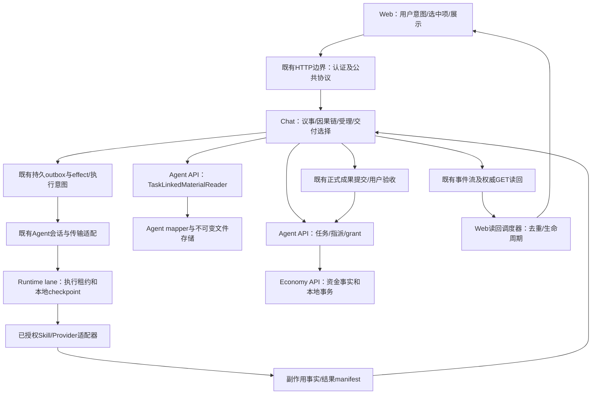

# 代码级设计

本文件描述**拟实现目标**；基线、已存在机制及未验证范围见[audit](audit.md)。目录缩写：

- `A-API`＝`api/agent/jia-agent-api/src/main/java/cn/jia/agent/`
- `A-SVC`＝`api/agent/jia-agent-service/src/main/java/cn/jia/agent/`
- `A-MAP`＝`api/agent/jia-agent-mapper/src/main/java/cn/jia/agent/`
- `C-SVC`＝`api/chat/jia-chat-service/src/main/java/cn/jia/chat/`
- `W`＝`web/src/composables/juyiting/`
- `R`＝`/home/isp/wsps/chcbz/isp-install/conf/codex-ws-agent/`

## 1. 目标边界与不变流程



图不是新增一套链路。新增的只是一个窄资料读取端口、一个Web内部调度模块及内部类型；不新建消息队列、数据库、HTTP入口或全局状态管理。

### 事实owner表（开发不得越界）

| 事实 | 唯一负责写入的域/现有入口 | 其他模块只能做什么 |
|---|---|---|
| Task状态/版本/指派 | Agent任务应用服务及`AgentTaskMutationTransaction`锁根 | Chat通过既有API能力调用；Web不推写任务完成 |
| Grant、assignmentRevision、需求版本 | Agent grant/requirement服务 | 消费快照，提交时由owner重验 |
| Runtime主体/installation/sessionGeneration | Agent认证与Chat连接注册边界 | owner从认证证明取得，不以task owner替代Agent owner |
| Request/turn/澄清/Action/outbox | Chat议事、typed admission、action服务 | Web展示、提交明确意图；Runtime回报证据，不自行验收 |
| 工作空间文件版本/链接 | Agent workspace服务及mapper | Chat读窄端口；不得新增直读SQL或返回storageUri给浏览器 |
| execution/result commit | Agent执行服务/SkillExecutionService | Runtime提供fence与真实结果；不自行写DB |
| Provider effect是否发生 | Runtime执行记录＋既有服务端effect回执 | 未知不能推成失败或重试成功；无供应商证据不保证恰好一次扣费 |
| 正式交付/用户验收 | Chat选择绑定＋Agent交付服务/既有事务 | 消息READY、文件上传完成均不能替代验收事实 |
| 资金/扣费/托管账本 | Economy posting与资金应用服务 | 不在重连/重试控制器直接扣款；不复制账本 |

各状态机保持原枚举、原数据库值和原版本字段。本期不迁表、不改历史快照/摘要。

## 2. B0：规格与约束落到现有入口

### 2.1 固定可交接输入

开工先核对四仓HEAD、远端develop和本包base，记录在既有handoff。`api/docs/interface-catalog/validation-policy.md`目前未在固定API commit中；它是当前用户要求的一部分，不能忽略，也不能私自把整份脏文件提交。Owner确定所属改动是否已合入或取得可用版本，记录完整commit或文件SHA和授权范围。

本包分析baseline不是强制开发checkout；若新候选包含已批准的校验删除，**保留这些修改**。B1–B4不恢复基线中的数量/版本硬限制。候选有语义差异时先逐符号比较并更新本包任务边界，禁止盲套patch。

### 2.2 复用validateLayering，不造架构平台

在`api/build.gradle:validateLayering`原doLast增加以下扫描；沿用现有失败汇总。检查在Flow随既有任务执行，不单独建流水线。

| 规则 | 精确判断 | 风险/失败范围 |
|---|---|---|
| G1 | main业务Java跨域导入`mapper`/`dao.impl`，或解析目标类实际位于另一业务域`*-service/src/main/java`；不能只检查包名含impl。`material/mat`按同域，starter装配和common基础设施单独分类 | 防止绕过应用边界；仅新增边失败 |
| G2 | main业务`service/`中新增`SecurityContextHolder`引用 | 防止新增隐式身份输入；保留5个既有路径/符号例外，不允许新文件 |
| G3 | Chat main源码不得新增Agent文件三表SQL的直接访问；按方法/表名记录现有例外。B2完成后删除两个已迁移方法的例外及storage_uri读取 | 防止新端口旁仍存旧实现；新访问禁止；存量方法精确例外，不能误删effectiveSelectors或inspection锁读 |
| G4 | 本包新增main接口/实现不依赖新Gradle项目、新HTTP路由、schema写入 | 保持本期范围；发现需先修改设计，不用注释绕过 |

实现细节：G1按main源文件package与路径建立域映射，支持static import和通配符（通配符按目标包登记，不能逃过检查）；剔除注释后解析import，不对源码字符串示例误报。对G3按方法识别Java文本块，使用JDK自带Compiler Tree API的parse能力定位两个迁移方法/其余旧访问，不运行类型分析/代码生成，不用简单花括号正则切割SQL；不新增外部解析依赖。例外文件拟放`api/docs/architecture-boundary-baseline.json`，键为`rule + sourcePath + importedTarget/usedSymbol`，并含owner、理由、退役批次；不含行号、不使用目录通配符，不复制每份源码摘要作为每天必须更新的门禁。G2记录精确类和方法，移动/新增出现必须裁定。

基线只用于**存量豁免**，不是认可所有旧实现。B0先根据evidence生成候选、逐条分类与真实候选对比；不能用当前新增违规自动刷新白名单。B2删掉对应例外，同提交生效。反射/拼接类名不在词法工具证明范围，差异自检禁止以这些方式绕规则。

Web复用现有ESLint与`juyiting-hall-conversation.test.js`；对新调度器禁止依赖Vue组件、业务API实例、localStorage和Provider。不对全仓加硬行数、复杂度分数或性能拒绝门槛。

### 2.3 规格—改动闭包

每批用[implementation-contract](implementation-contract.json)核对`git diff --name-status <base> <candidate>`，路径需命中该批；同一文件内还须命中tasks列的符号。版本号/锁文件/测试配置改动亦必须解释，不因路径匹配就允许无限修改。

这是Owner自检＋已有检查，不另建审批/Reviewer。工具未实现时状态为pending，不说“已强制”。真正合入条件是：合同ID、旧入口删除、关键回归执行数/skip、候选SHA齐全；无法证明的批次不能标complete。

## 3. B1：类型化可恢复性，保留现有快照和wire

### 3.1 修改位置及形状

修改`A-API/service/TaskSkillPolicyService.java`，保留Snapshot现有五个record字段/构造器/equals。增加嵌套enum和纯分类方法：

```java
enum Decision { ALLOWED, DENIED, TEMPORARILY_UNAVAILABLE, INDETERMINATE }
// Snapshot内新增；仅Java内部使用，不作为HTTP/WS字段。
Decision decision();
```

决策表是实现合同，不使用异常message或substring：

| 当前快照 | decision | effect/dispatch行为 |
|---|---|---|
| allowed=true，原构造约束成立 | ALLOWED | 继续现有fence/grant/installation/摘要重验；不直接授权Provider |
| allowed=false，RUNTIME_UNAVAILABLE | TEMPORARILY_UNAVAILABLE | 不建新child，不标永久拒绝，沿用outbox retry |
| allowed=false，TASK_NOT_ASSIGNED / TASK_GRANT_MISSING / TASK_GRANT_STALE / ASSIGNMENT_EPOCH_UNPROVEN / REQUIREMENT_STALE / SKILL_BASELINE_REQUIRED / RUNTIME_FENCED | DENIED | 沿用现有确定拒绝，不能把身份不匹配伪装重连 |
| allowed=false，null或未识别reason | INDETERMINATE | 不授权、不永久拒绝；报告未知原因并沿用可恢复失败；不推断新语义 |
| read抛Failure.NOT_FOUND / SOURCE_UNAVAILABLE / INTEGRITY_ERROR | 非Snapshot | 保持既有错误映射，不能用空allowed快照吞掉异常 |

方法不得新增wire字段；若序列化框架可能自动发现，则显式ignore并用既有wire测试核对。boolean/reason暂留是兼容字段，不引入两套持久化规则；所有生产端reason集中于原policy实现，不改数据库。

### 3.2 调用者迁移表

| 文件/符号 | 改动 |
|---|---|
| `A-SVC/service/impl/TaskSkillPolicyServiceImpl.read/denied` | 对照决策表核对所有reason生产者；不改主体解析、不新加校验 |
| `C-SVC/service/ChatActionExecutionService.requireAvailablePolicy` | switch decision；ALLOWED仍要求runtimeScope；DENIED用既有Rejected；其余用局部可恢复异常，不匹配reason字符串 |
| 同类`prepare`中的连接变化/无连接 | 用同一局部可恢复类型表达；grant/manifest冲突继续原Rejected，不扩大重试语义 |
| `C-SVC/service/ChatActionDispatchService` | 可增加嵌套`Unavailable extends IllegalStateException`保存原因码，保留原SKILL_RUNTIME_UNAVAILABLE/CHANGED message兼容现有诊断，不继承Rejected；不创建通用异常平台 |
| `C-SVC/service/ChatDeliberationOutboxRelay` | 原有Rejected→reject/其他异常→retry逻辑保留；日志可读取Unavailable原因，不改claim/lease/次数策略 |
| `C-SVC/service/ChatActionCapabilityService.taskCatalog/available` | callable仅decision==ALLOWED；仍输出旧reasonCode和旧目录形状；不新增权限、不把未就绪当免费可用 |
| `A-SVC/service/impl/PersonalWorkspaceExecutionServiceImpl`技能policy消费者 | 改用decision，原失败类型和fence重验保持；禁止连带重构其他执行协议 |

null policy映射暂按原消费者的安全失败；不能把缺实现当ALLOWED。不得在本批改变HTTP状态码或前端文案。

### 3.3 事务、幂等、恢复不变量

- `ChatActionDispatchService.consume`仍NOT_SUPPORTED，包/准备I/O在锁外；事务内锁序仍task root→binding→conversation→outbox。
- 准备与写入之间仍复核当前policy/fence；连接轮换只能引起本次受理重试，不能复用旧session授权。
- 同actionEventId导出的executionId/runId/key、sourceSnapshotDigest算法不变。
- 不确定受理通过原幂等键查证；不得换键再发一次。Provider副作用未知不自动重放。

## 4. B2：Agent拥有任务资料读取事实

### 4.1 本期只迁移普通读取

新增`A-API/service/TaskLinkedMaterialReader.java`（一个真实跨域端口），实现位于`A-SVC/service/impl/TaskLinkedMaterialReaderImpl.java`。沿用`PersonalWorkspaceTaskLinkService.Scope`，不再造授权Context。

```java
interface TaskLinkedMaterialReader {
  record Selection(String fileId, int version, String purpose) {}
  record Metadata(String contentMimeType, String sha256, long byteLength) {}
  Metadata metadata(PersonalWorkspaceTaskLinkService.Scope scope,
                    String taskId, Selection selection);
  PersonalWorkspaceStorage.StoredContent read(
      PersonalWorkspaceTaskLinkService.Scope scope, String taskId,
      Selection selection, Metadata expected);
  // 局部Failure持有Reason：NOT_FOUND、UNAVAILABLE、METADATA_INVALID、CONTENT_MISMATCH。
}
```

这个内部Java接口不是HTTP endpoint；不提供`skipAuthorization/allowMissing`开关，不返回storageUri，不由客户端提交scope来授权。Chat在进入端口之前继续现有conversation/task/assignment/Agent身份检查；端口对owner/client/tenant/task/文件版本/链接做自己的事实校验。

### 4.2 DAO和SQL合同

复用`A-MAP/dao/PersonalWorkspaceTaskLinkDao`、`dao/impl/PersonalWorkspaceTaskLinkDaoImpl`及`mapper/PersonalWorkspaceTaskFileLinkMapper`；新增查询方法`findActiveMaterial`/`selectActiveMaterial`。内部record保存MIME/hash/length/storageUri；storageUri止于Agent内部。

- 复用`ChatSkillSourceAccessService.workspace`现有exact二进制scope/ID连接条件：tenant、client、owner、task、file、version、role均匹配；link/file均ACTIVE；role仅既有INPUT/REFERENCE。
- 读取结果必须唯一；零行或多行=NOT_FOUND（沿用旧rows.size()!=1的不可见行为，不择一放行）；不完整元数据=METADATA_INVALID；内容字节不一致=CONTENT_MISMATCH；DB/存储I/O不可用=UNAVAILABLE。不用`LIMIT 1`掩盖重复事实。
- `metadata`为普通只读查询，不持有写锁；不在本批增加任务状态/格式/数量条件。已存在字段类型/版本可表示性仍由既有输入边界处理。
- `read`：查真实链接及版本→比较expected三元组→通过原`PersonalWorkspaceStorage.read`读取并验证摘要/长度→再次查当前链接及版本并比较→返回StoredContent。读取期间不可变内容被校验，动态授权在I/O后重验。
- 2026-10-26真实MySQL回归补充：NOT_SUPPORTED仍可能启用Spring同步并复用MyBatis SqlSession，默认一级缓存会让I/O后的相同SELECT命中旧授权。仅`selectActiveMaterial`设置`@Options(useCache=false, flushCache=TRUE)`，使两次验权均查询数据库并避免二级缓存；不改全局缓存配置、不扩展锁/事务范围。失败范围仍为当前读取NOT_FOUND；回归为TaskLinkedMaterialReaderMySqlTest.proxySuspendsRepeatableReadAndSeesRevocationAfterStorage及既有mapper合同断言。
- 不为减少查询删除最后一次授权检查；不跨主体/版本缓存结果。不在数据库写事务中持有文件I/O。
- `read`在Spring实现上使用`@Transactional(propagation=NOT_SUPPORTED)`，禁止把文件I/O和两次授权读取包进同一重复读快照；`metadata`不新增事务边界，继承原调用语义。基线`ChatMaterialsInputService.read`先完成withAuthority事务，再sources.read，再次withAuthority；`PersonalWorkspaceExecutionServiceImpl.inputContent`也先准备、锁外读取、最后nativeMutation复核。当前两条调用链可保持这个顺序；后续调用者不得把未提交链接作为read输入。事务效果必须通过代理实例/真实MySQL检验，不能self调用假定注解生效。

### 4.3 两个消费者，保持外部语义

1. `ChatTypedDeliberationContextService.workspace`：selector→Selection；metadata→原source函数；sourceKind仍`TASK_WORKSPACE_FILE`，sourceRefId计算、排序、canonical bytes不变。
2. `ChatSkillSourceAccessService.requireAuthorized/workspace/read`的`TASK_LINKED_WORKSPACE_VERSION`分支：用reader取得事实和内容；filename仍`material`；来源identity和manifest字段不变。返回前的会话/retention重验仍保留。其他三类source分支完全不动。
3. 异常适配：NOT_FOUND两处均走原missing；METADATA_INVALID在typed context走原unavailable、在skill source走原missing；CONTENT_MISMATCH在skill content走原conflict；UNAVAILABLE走原基础设施不可用映射，不伪装资料不存在。expected三元组与当前版本不匹配是NOT_FOUND，实际读出字节不匹配才是CONTENT_MISMATCH。原接口错误信封/HTTP映射不变。
4. 删除这两个消费者已经迁走的SQL/存储定位实现和仅为它们存在的依赖；不能把旧实现作为fallback。若JdbcTemplate还用于effectiveSelectors或别的source，不删整个字段。

**明确不迁**：effectiveSelectors(TASK_DEFAULT)的选择集合查询；ChatTypedInspectionContextService普通读；ChatInspectionAuthorityService的FOR UPDATE；它们记在旧债基线，不对外宣称“全项目资料SQL已统一”。后续是否可共用需单独处理锁读/不可见映射，不强行合并。

### 4.4 保留校验的规格依据

| 校验 | 保护风险 | 失败范围/行为 | 关键回归 |
|---|---|---|---|
| exact tenant/client/owner/task/link/version | 跨账号或跨任务拿错文件 | 仅本次读取失败；不暴露文件是否存在 | 同ID错owner拒绝；真实owner成功 |
| file/link ACTIVE、固定版本 | 已撤销资料仍被读取、错版本改图 | 当前读取不可见；不删历史事实 | 撤销前可读，读取中撤销后不返回内容 |
| expected MIME/hash/bytes与实际一致 | 选中内容与执行内容被替换 | 当前读取完整性失败，不自动换最新 | 同版本真实字节匹配；不匹配不得Provider启动 |
| I/O后重验动态授权 | 存储读取期间权限变化 | 当前调用失败，已保存不可变证据不改写 | 复用并发撤销关键用例 |

没有新增格式白名单、应用版本门禁或文件数量上限。这个表不能为其他旧校验自动背书。

## 5. B3：提取读回调度，保留前端业务投影

### 5.1 新内部模块

新增`W/hallRequestReadbackScheduler.js`，只负责inflight/jobs/定时器。沿用JS，不引入新状态库或依赖。

```javascript
createHallRequestReadbackScheduler({
  read,                // async (requestId, guard) => boolean，原请求/投影逻辑
  captureGuard, isCurrent, isActiveRequest,
  setTimeout, clearTimeout, debounceMs // 生产传入原250，不新增超时
})
// 返回 readNow(id, guard?), schedule(id,{immediate}),
//      hasInFlight(id), reset(), dispose()
```

- `read`注入的是原recoverUnknownRequest中的**单次GET及合法性/应用投影部分**，不含调度Map。模块不能直接调用chatApi、修改messages/activeRequest或推导任务状态。
- 内部保留每个requestId的inflight和job；另有epoch保护reset/dispose，避免旧promise finally清除新作用域的job。
- key在单个scheduler实例内按requestId；其生命周期由原conversation scope管理。切身份/会话须reset并增加epoch，不能跨用户共享模块全局Map。
- readNow同scope/id并发返回同一个Promise；对已失效guard不启动GET。完成后只有map中的同一promise可以移除inflight。
- schedule普通delta复用原250ms尾沿；在读期间记录dirty，结束后补一次；immediate结束/缺口事件读期间记录forceTrailingImmediate，结束后立即补一次。不得吞掉终态事件。
- reset清定时器与map，不自行改变业务状态；HTTP AbortController仍由useHallConversation原生命周期持有并取消。旧GET即使不能取消，其apply guard必须阻止落到新scope。
- dispose使后续schedule返回false，readNow返回resolved false，不产生请求。不允许timeout改变业务执行状态。

### 5.2 原文件改动闭包

`W/useHallConversation.js`删除两个Map及调度函数重复实现；原函数名可以作无逻辑代理以减少调用面：

| 原符号 | 迁移 |
|---|---|
| requestReadbackJobs/requestReadbackInflight | scheduler私有 |
| recoverUnknownRequest | scheduler.readNow代理；原GET/版本与绑定检查成为注入的read |
| runScheduledRequestReadback/scheduleAuthoritativeRequestReadback | 移入scheduler；原调用点调用schedule |
| resetDurableState/最终dispose | 调scheduler.reset/dispose；保留原stream/poll/lifecycle清理 |
| roundCloseout的inflight检查 | 改hasInFlight，无旁路Map |

保留：requestRevision/conversationGeneration绑定、stateVersion不倒退、已终态不能回RUNNING、bootstrap关联、SSE消息处理、isAwaitingReply轮询条件、失败文案、1.5/5秒同步和2秒reply轮询频率。不得把所有监听合并成一条timer。

不改`useHallTypedDeliberation.submit`、路由、按钮、原型；若出现可见行为变化，停止把它称“纯重构”，先按原型先行处理。

## 6. B4：Runtime按失败范围报告poll

修改`R/skill-conversation.mjs:SkillConversationLane.poll`与`R/agent-client.mjs:startNativeConversationPoller`，不动Provider调用/effect协议。

返回形状（内部JS，不是网络wire）：

```javascript
{
  status: 'IDLE' | 'BUSY' | 'PROGRESSED' | 'PARTIAL' | 'DEFERRED',
  processed: 0,
  deferred: 0,
  executionErrors: [{ executionId, code }]
}
```

互斥判定顺序：已有active→BUSY；有executionErrors→PARTIAL（processed允许0）；否则processed>0→PROGRESSED（可同时有deferred）；否则deferred>0→DEFERRED；否则IDLE。只有整次共享错误throw，不返回伪PARTIAL。

- pendingCommands中已隔离的历史command错误及process中已认定command-local错误写入executionErrors；每条保持原code，未知字段不猜测成成功。
- 原未知错误、共享session/scope/store/API origin错误和页面整体无法解析仍抛出；新页command预解析当前在循环外，**本批不将其擅改逐条容错**，以免吞掉跨主体冲突。
- UNKNOWN沿用原15秒至5分钟退避与向下抖动；不因report改变再次执行/查询行为。
- poll的active finally释放不变。Promise等待、关闭前停止poll、重新注册绑定不变。
- caller记录PARTIAL及processed/deferred/error count；原catch仍用于整体故障。不能看到processed>0就打印全部成功。
- 日志含profile/已有executionId/code，不打印token、文件内容、完整command。无需新监控后端；若要关联task/run，只使用已知command字段，不通过额外远程查询补齐。
- 旧Native lane可能仍返回`{processed}`：caller只在明确识别status时用新日志，其他返回保持旧处理，不凭多形状猜测执行协议。其余lane无需同步升级。

## 7. 后续设计边界（非一期实施授权）

| 债务 | 下一份代码任务必须补齐什么 | 不能做什么 |
|---|---|---|
| SkillExecutionService从巨型workspace类分离 | 每方法private调用闭包、所有DAO/事务传播、注入唯一性、未决执行恢复；先抽effect或source窄职责 | 仅把全部方法搬入另一个巨型Support；改变事务代理为self调用 |
| AgentWebSocketHandler拆分 | registration/session拥有者、每messageType handler、调用者与断开清理顺序 | 新旧handler同时注册/双写session；运行版本硬匹配 |
| 可信身份上下文 | 5个旧入口所有调用者、边界证明构造、worker获取身份方式、拒绝语义 | 删SecurityContext检查后接受任意scope；HTTP框架对象进入新领域服务 |
| Economy权益与Agent安装分界 | 表/字段读写owner及REQUIRED事务；应用API列表；不迁表的适配顺序 | 为消依赖分布式化资金事务；双写权益 |
| Web操作投影权威化 | 请求/成果/澄清选择合同、revision/失效、GET快照非授权、写时重验、PC/移动原型 | 默认最新成果、历史不明就放行、凭UI projection代替授权 |
| 知识库空实现/统计 | 实际调用闭包，未用接口的退役或明确unsupported；失败映射 | 上线自动清理、修改保留策略、把ES不可用当零条 |

## 8. 混合部署与恢复

- B1/B2是API内部变化，HTTP/WS/数据库不变；B3仅Web内部；B4仅Runtime poll内部。各组件可独立验证，不强制同日全量升级，不因版本号不同拒绝工作。
- 顺序建议API B1+B2→Web B3→Runtime B4，分别使用精确commit/tree、同Run制品和已有安装流程；发布授权另行确认。
- 本期没有DDL、存量回填和新Provider副作用策略。仍须在发布前核对真实候选没有混入其他任务的迁移。
- 回退只恢复已核验兼容程序，不恢复旧DB/运行状态；同action/execution/checkpoint继续读取原事实。若候选含其他迁移，不套用本期无DDL回退结论。
- API/Web/Runtime版本、候选SHA、安装文件SHA和线上结果分别记录；Flow成功不能替代业务通过。每Run≤600秒，超时受控结束，不以拆Run凑时限、删关键回归或回本机构建规避。
