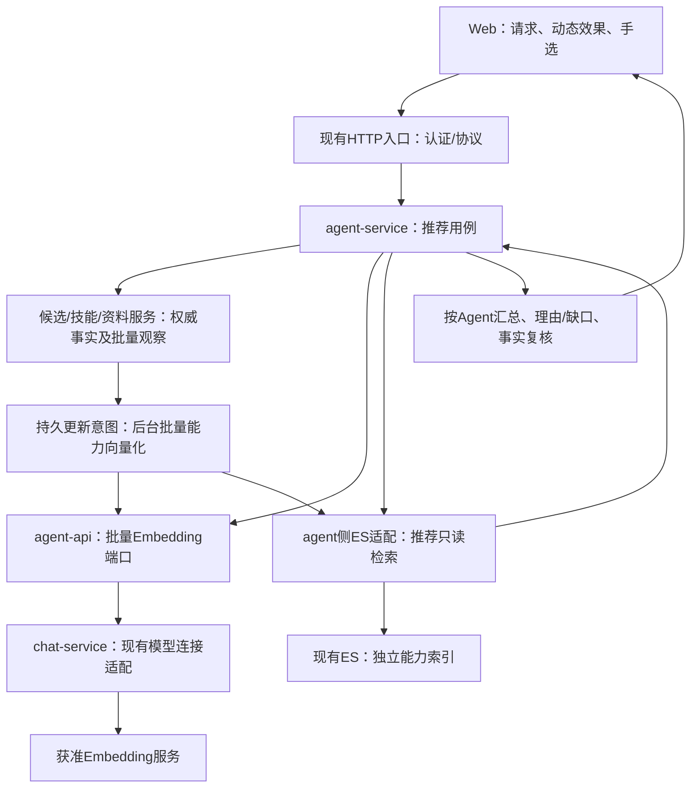
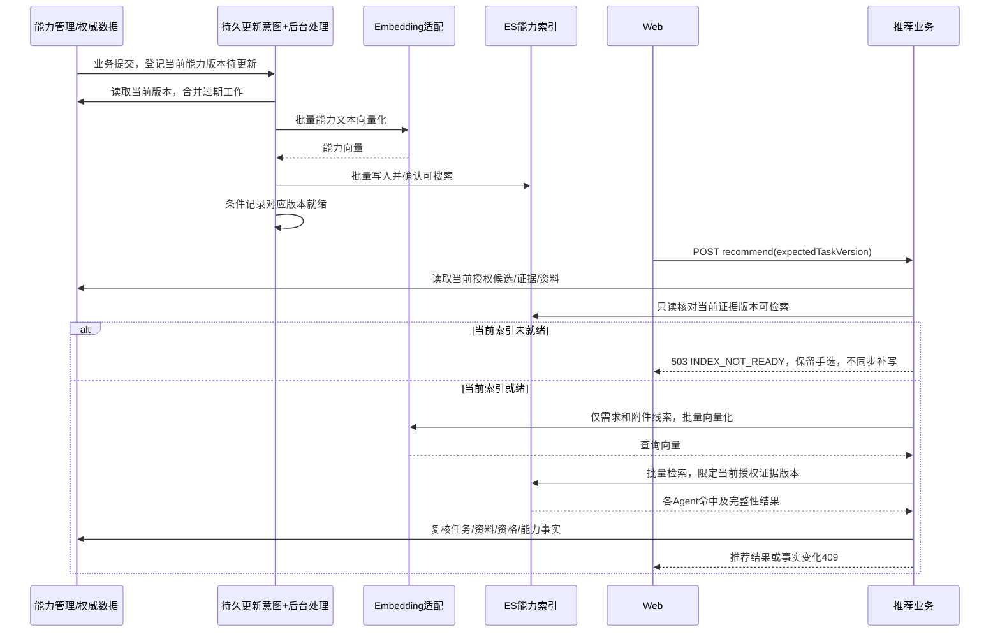

# 推荐承办：Elasticsearch向量检索概设 v3（最小闭环）

日期：2026-11-01，Asia/Shanghai。Owner：当前会话。
状态：**2026-11-01用户决定暂缓：新方案尚不成熟，仅记录，不实施/测试/上线。** 后续“向量召回＋一次模型识别必要技能，技能过滤、本领参考排序”也仅保留为待验证方向，不移植整套算法到现有链路。 覆盖v2“推荐请求内补索引”及更早“Redis缓存＋API精确计算”方案；不覆盖现行已上线R1合同，不保留两套推荐实现。本次只改文档，不操作ES、模型配置、用户数据或部署。

## 1. 设计结论

**复用现有ES连接，建立独立能力索引；Embedding负责向量化，ES负责相似度检索，API负责权限、技能事实、按Agent汇总与推荐解释。** 不复用聊天记忆索引，不新增ES集群/服务、Redis向量缓存、消息队列或通用索引平台。

最小闭环分为两条内部职责链：能力变更后异步向量化并更新索引；推荐请求只读取已就绪的当前索引版本、批量向量化需求/附件线索、检索和汇总。推荐链路不生成能力向量、不写ES、不等待索引refresh。两条职责链仍只有一套推荐接口。

第一版采用**候选范围内精确向量检索**，先保住多附件覆盖及可解释性；不是“ES就必须ANN”。不同时维护精确与ANN两套路径。若固定规模性能验证不满足目标，在定案时调整为ANN召回方案，而非无依据承诺精确检索可无限扩展。

“纯向量还是保留生成判断”尚未获用户确认。本文默认拟议的纯向量相关能力推荐；ES选型不等于用户已经同意删除具体澄清/复杂需求推理。该产品取舍是实施前需澄清事项。

## 2. 核对基线与证据边界

前一轮分析已fetch API/Web develop（本次改稿未重新fetch，不宣称仍是远端最新），固定源码读取使用git show/git grep，不使用共享脏工作区冒充受测代码。

| 对象 | 固定基线/状态 |
|---|---|
| API origin/develop | `2a8a67c58c1949d671a4952bac496527ec1f3cea`；tree `6ed7f2ae3fbaf24ea0edca24e05ce2bb02d6e2ec` |
| Web origin/develop | `e6a95da175384ab8ed7d34337fc7a45f2d92ef60`；tree `4b792f1eff9a9f801af8b0029c0cbcec653b51b0` |
| API安装记录 | Run421 / 上述API commit / installed |
| Web安装记录 | Run388 / `709d30ddb77f4e8b33d405093b6b4a75585a2e64` / online_verified；不是当前远端HEAD |
| 本地API/Web HEAD | `516267b...` / `ca22ac2...`，有其他任务修改，不作为本次产品事实基线 |

安装记录来自 `/home/isp/state/cyf-api-flow/record.json`、`/home/isp/state/cyf-web-flow/record.json`；不是本轮重新在线验收。

规格依据：
- `/home/isp/wsps/cyf/AGENTS.md`，尤其2026-10-30最小联动和责任层规则。
- `/home/isp/wsps/cyf/api/AGENTS.md`。
- `/home/isp/wsps/cyf/specs/juyiting-assignee-recommendation/spec.md`（现行R1）。SHA256 `9c10a95a8fb5efd0e3a129aae2b2a2b323bcde1c29db96f1cba38d7a2317718d`。
- `/home/isp/wsps/cyf/specs/juyiting-skill-execution/responsibility-boundaries.md`（RB-1）。SHA256 `2ae3135d4c24b1315dad8093fb5e6ac8182d0f81d82489c0b55367e0925f4b72`。
- `/home/isp/wsps/cyf/api/docs/interface-standard.md`：工作区现行v1.4，SHA256 `2d36ffac1dc52c6db8d54b860695edd845b6688ea0808528c53218e39aec7a08`；固定API提交内文档仍标v1.2。实施按用户现行v1.4，不回退历史文档，也不顺手全量迁移接口。
- `/home/isp/wsps/cyf/specs/api-performance-3s-slo/spec.md`：采用最新“观测而非拒绝/截流”修订。
- `/home/isp/wsps/cyf/docs/implementation/handoffs/JYT-MODEL-RECOMMEND-20261028.md`：既有上线与409未闭环事实。

核对覆盖推荐的Controller/DTO/Service、资料与技能观察、候选与外单入口、模型适配和现有Embedding/记忆/Redis实现、Web解析/请求生命周期/展示及相关测试。不是全仓逐文件审计，也未验证生产Embedding端点、实际候选规模或性能容量。

## 3. 当前代码究竟怎么做

下列API路径均相对 `/home/isp/wsps/cyf/api/`，源码取上述固定提交；Web路径相对 `/home/isp/wsps/cyf/web/`。

| 位置 | 当前事实 | 对方案的影响 |
|---|---|---|
| `agent/jia-agent-service/.../api/AssigneeRecommendationController.java` | 单一路由POST `/agent/tasks/{taskId}/recommend`，认证与现有错误封装 | 不另建v2路由/信封 |
| `agent/jia-agent-core/.../entity/AssigneeRecommendation.java` | Request版本；Result含state、summary、recommendations、questions、candidateSetComplete | 尽量保持结构，但同步修改语义与Web文案 |
| `agent/jia-agent-service/.../recommendation/AssigneeRecommendationService.java` | 前后读取任务/候选，单次model.judge，服务端重组证据 | 替换生成判断；保留授权与事实复核，不把缓存当权限 |
| `agent/jia-agent-service/.../impl/AgentServiceImpl.java#listTaskAssigneeCandidates` | 外单候选全分页；自有候选逐个取abilities；外部abilities为空 | 外部当前不能获得正面能力推荐，不得偷读私有技能 |
| `agent/jia-agent-service/.../skill/SkillManagementService.java#recommendationSkills` | 每Agent查产品，每安装查授权/版本，复用管理链判断可引用性；catalog前后整体比较 | 有N+1与重复产品读取；批量优化在技能服务内部，不复制真实性校验 |
| `agent/jia-agent-service/.../recommendation/RecommendationMaterials.java` | ACTIVE INPUT/REFERENCE，按关联版本读取文件名/MIME；旧版本另分页；summary固定null | 不拿最新版本代替；不扩建摘要生成；资料读取亦有按文件访问成本 |
| `chat/jia-chat-service/.../recommendation/AssigneeRecommendationModel.java` | 直接ChatModel，无工具/记忆，Prompt同时理解需求与输出理由/澄清 | 移除本用例生成适配，不改其他聊天、团队推荐或自动指派 |
| `chat/jia-chat-service/.../memory/MemoryRepositoryImpl.java` | 注入EmbeddingModel；ES存记忆向量、按owner检索；维度默认1024；当前生成入口单文本 | 有底层能力，**不是现成的能力索引**；不能用记忆服务承载能力/附件 |
| `starter/.../application-prod.properties` | 声明embedding=openai、模型text-embedding-3-small、dimensions=1024 | 是源码配置值，不是连接可用/生效值证据 |
| `chat/.../ai/OpenAiChatTransportCustomizer.java`及对应测试 | chat专用传输处理明确不命中`/v1/embeddings` | chat已跑通不代表Embedding复用路径已跑通 |
| `common/jia-common-service/.../redis/RedisService.java` | 已有Redis访问/过期等基础设施 | 本次推荐不引入Redis向量缓存；原有其他用途不变 |
| Web `src/composables/juyiting/hallAssigneeRecommendation.js`、`useHallData.js` | 校验R1；身份/事项隔离；在途合并；重推先GET；缓存生命周期 | 保留现有交互，不能以旧结果缓存跳过服务端事实检查 |
| Web `src/components/juyiting/BountyPanel.vue` | 仍显示“需求理解”“模型建议”；手选独立于推荐 | 纯向量切换需要少量文案与测试联动 |

现行测试已经覆盖：授权候选/引用真实性、不可用技能、INSTRUCTION经验、离线提示、外部无证据、无候选、失败不重试、任务/资料变更、确切历史版本、任意文件类型等。方案不能因删除生成解析而丢掉这些业务覆盖。

**409现状**：前端显式重推已刷新事项，但历史上线验收中首次自动推荐仍复现409。服务端完整Candidate比较包含状态/展示字段；技能服务catalog整体比较也可能导致CHANGED。这是应定位的变化面，不是已确定根因。换成向量不会自动修复。

## 4. 架构与职责

| 层 | 唯一职责 | 不做 |
|---|---|---|
| HTTP认证入口 | 建立可信身份和环境上下文，协议输入 | 不接受用户覆盖tenant/owner或索引名 |
| agent推荐业务（RB-02） | 查询/能力文本、推荐规则、事实快照与结果 | 不解析文件正文、不编排执行技能 |
| 候选/技能/工作空间服务 | 授权候选、可引用技能、确切资料版本；在原层批量读取 | 不为向量另复制一套真实性规则 |
| agent侧ES适配 | 根据可信上下文落实索引分区、查询过滤、bulk、搜索响应完整性 | 不把ES中存的状态当授权；不承载生成模型调用 |
| chat侧Embedding适配 | 批量向量化、响应校验、复用连接/解密与错误处理 | 不承担能力排名、不调用聊天记忆 |
| Web（RB-01） | 权威结果展示，保留防误操作/在途合并 | 不计算分数、不新增思考流/SSE |
| Runtime（RB-03） | 本次不改 | 不新增能力扫描/文件解析协议 |

物理落点：ES适配优先放agent的持久化/存储适配位置（`jia-agent-mapper`），业务编排留在service；与普通Mapper一样被service调用，不让mapper反向依赖service。复用 `ElasticsearchClient` 连接与共享依赖版本，不为推荐扩展通用ES框架；实施时确认mapper现有依赖并做validateLayering。Embedding端口保持agent-api → chat-service实现的原依赖方向，不让agent依赖chat-service。

## 5. 索引：只保存能力的检索投影

索引逻辑名示意：`cyf_assignee_capability`；物理索引按模型/维度/文本模板代次区分。最终名称、mapping和客户端API须按实际ES版本核对，本稿不把示意名当已建资源。

**一条本领/安装技能的一个语义版本，对应一条文档**。字段限于：

| 字段 | 用途 |
|---|---|
| 环境tenant/client、owner分区 | 存储适配器强制过滤，取自可信上下文 |
| agentId、evidenceKey、kind | 将命中绑定当前候选的证据，不靠名字匹配 |
| contentHash、modelRevision、templateVersion | 精确识别文本/模型代次，防止混用旧向量 |
| embedding | 固定维度向量，由指定Embedding模型生成 |
| createdAt | 投影清理和排查使用，不是授权/就绪时间 |

不要求在ES重复保存完整技能文本；名称、说明、可引用性与最终展示由当前权威观察取得。需要排查时用摘要和证据标识，不记录用户正文。**任务描述、附件名称/摘要及查询向量只在本次请求内使用，不持久写入能力索引。**

文档ID按“可信分区＋Agent＋稳定证据键＋内容摘要＋模型/模板代次”确定。同一内容同一证据重复写幂等；文本变化生成不同ID，避免较旧请求覆盖新版。当前本领证据是数组位置，若本领顺序改变会产生新映射，必须结合内容摘要，不能把位置本身当稳定身份。技能用安装ID关联，卸载重装不冒用旧安装证据。

运行在线/忙闲、技能启停、准入、catalog/fence和权限**不作为索引权威**。它们由每次推荐的业务观察决定哪些精确文档ID允许检索。索引不提供新权限。

## 6. 索引更新：提前构建，读写分离

v2为减少同步实现而将索引补齐放进推荐请求，会把能力Embedding、bulk和可搜索等待一起放进用户等待路径；不符合本任务优先性能的要求，现撤回。**最小闭环不应省掉必要的后台索引更新。**

### 写入链路

1. 本领新增/编辑，技能安装/升级、用途说明变化，成功提交后安排对应能力的更新。只针对实际影响语义文本/归属的变化，不因心跳、普通忙闲重复生成向量。
2. 变更意图必须可恢复：优先核实已有持久任务设施能否承载；若没有合适入口，增加本用例最小的待更新记录（目标、期望内容版本、状态/失败信息），与相关业务变更同事务登记。外部Embedding/ES调用不在业务事务内。
3. 复用现有调度执行设施异步处理，重新读取当前权威内容、合并同目标连续变更、批量Embedding/bulk。不能仅用易丢失的内存事件或裸线程。
4. 逐项处理bulk结果，确认对应文档可搜索后才记录当前版本就绪。旧任务完成不能把新版状态回写成旧版；由内容版本和条件更新保证。
5. 失败保留待处理/失败事实，推荐请求不替它重试；重试须有归因、去重和受控策略，不无限重发可能已计费的Embedding。明确网络不确定时可能重复计费，不承诺恰好一次。

**现有代码仅确认存在Agent命令传输outbox，不代表它是通用索引队列。不得把索引工作塞进Runtime命令合同。** 具体复用入口与是否需要最小记录表，实施前定向核对；这取代v2“不改任何SQL结构”的过早承诺，不扩为通用事件平台。

### 初始化、增量和失效

- 首次启用推荐前，获准批量构建现有能力索引并核验可搜索；不让第一个用户承担全量初始化。
- 模型/维度/模板升级在后台准备完整新代次后切换；每次推荐固定使用一套代次，不混用向量。
- 禁用、卸载及权限变化由当前权威集合立即过滤，不等待后台删除，不以旧ES文档授权。
- 新能力/新内容版本尚未就绪时，不返回旧证据冒充当前内容。首版明确返回503 `RECOMMENDATION_INDEX_NOT_READY`，展示“能力索引更新中，暂无法完成推荐”，保留手选；这是数据未就绪，不是性能超时门禁。
- 不把缺索引当NO_MATCH，不在请求内等待、补写或自动轮询；其余候选部分推荐不进入首版，避免引入另一套完整性语义。需要降低暂不可用窗口靠批量增量处理和就绪延迟优化，不靠伪装完整结果。
- 增量任务恢复/对账负责发现漏更新及缺失文档；身份/资料保留规则下的索引删除、旧版本清理纳入交付，保护在途引用。按已授权环境/分区执行，不全索引无差别清空。

## 7. 查询与多附件汇总

### 输入

- 整体需求：标题、描述、显式requiredAbilities。
- 显式能力要求：各项单独查询，避免长文本掩盖其中一项。
- 每份资料：任务目标上下文＋资料名＋原文件名/后缀＋MIME＋角色＋已有摘要。
- 只读ACTIVE INPUT/REFERENCE的确切关联版本；摘要目前为null，不补造；不读正文，不限定类型、不写后缀→技能规则。
- 规范化相同查询去重，但保留资料对应关系；不按后缀粗暴合并不同资料，不删否定词或任务意图。

### 批量检索与候选覆盖

**逻辑上每个查询单独检索，传输上批量Embedding和ES多搜索；不是逐附件串行HTTP，也不把全部附件压成一个向量。** 超过实际Provider/ES批量限制时受控拆批；不创建每附件一个无界线程。

首版在“可信分区＋模型代次＋当前可引用证据文档ID”内做精确相似度检索，再按Agent得到每个查询的最佳命中：

`match(agent, query) = max(similarity(query, 当前该Agent的可引用证据))`

ES实现候选采用 `script_score`＋按agentId折叠取最高分；每个查询保留当前各候选的最佳证据，**不先全局Top-K后再汇总**，避免技能多的Agent占满检索结果，漏掉其他Agent对某个附件的唯一支持。具体DSL在固定ES版本做集成验证，非已验证实现。

候选较多时按不重叠候选组/精确ID集合拆批，完整合并后再排序，不静默截掉未检索候选。响应文档排除embedding数组。原始匹配文档计数/返回完整性与预期集合核对，任何搜索分片失败、超时或缺失批次不能当作完整推荐。小规模精确检索是当前拟议实现，不承诺规模无关的固定耗时。

### 业务汇总

- 每个查询取每个Agent的最强证据，不累加同类技能数量；相同附件查询不重复加权；最终证据引用去重。
- 总体需求及明确能力要求是主要判断依据；附件匹配补充短需求并给出覆盖线索，REFERENCE未命中不直接淘汰。
- 阈值与排序参数通过固定反例/正例语料校准，不拍脑袋写0.8，也不照搬ES原始_score为成功率。适配器统一记录实际相似度变换，避免不同查询方式分数混用。
- 不把“每个附件都有一个命中”等同于“业务所需能力全部识别”。否定、多个条件、跨附件关系是纯向量需验证的风险。
- 由API生成可追溯理由及缺口：“资料X的元信息与能力Y相关；未读取正文”。不编造图片内容/文件摘要，不把已安装经验声称为执行成功保证。

## 8. 两条时序，推荐不承担写入

返回前仍以业务事实为准。索引命中不替代最后复核或确认承办授权。推荐请求既不写索引，也不触发能力向量补齐；异步索引和推荐查询期间均不持有业务数据库事务锁。

## 9. 接口、交互及失败语义

保留 `POST /agent/tasks/{taskId}/recommend` 和现有公共信封；不新增另一套检索推荐HTTP接口。

若确认纯向量路线，Result结构尽量不变：
- READY：有足够相关且可引用的能力证据；不是执行已就绪。
- NO_MATCH：候选存在，检索输入/索引完整，但没有足够相关证据。
- NO_CANDIDATES：授权候选为空。
- 不从低相似度编造具体澄清问题。是否移除本用例NEEDS_CLARIFICATION生成及对应前端分支，待用户确认；未确认前不删除现行功能。
- `candidateSetComplete`仍只指权威候选观察完整；不得拿它代替索引或搜索完整性检查。
- 当前所需索引未就绪：503 `RECOMMENDATION_INDEX_NOT_READY`；ES/Embedding不可用、搜索部分失败：503；后台bulk失败保留失败状态，不侵入推荐请求；向量结构/维度非法：502；任务/资料/资格/能力事实变化：409。原认证与资源错误不变。
- 无自动外部调用重试、无旧生成方案兜底、无随机/零向量兜底；部分成功文档可供下一次显式重推复用。

Web保留已有动画、重复请求合并、身份/事项切换取消、重推前刷新、防误操作和手选入口。纯向量时只将“模型建议/需求理解”文案改为“能力匹配建议/匹配依据”，同步本用例原型与测试，不新增思考流。

已有409仍需要安全的变化类别诊断（task/material/candidate/evidence）。普通展示字段与业务依据分开；在线变化若影响技能可引用性仍须使旧推荐失效。catalog语义比较在技能管理层处理，不由推荐服务绕过fence/身份/版本校验。ES方案不代表既有409根因已定位。

## 10. 性能与费用：具体约束，不虚报秒回

- 权威读取的N+1仍在原服务层定向批量化；ES不能消除这部分数据库开销。
- 推荐始终只为查询文本生成向量；能力向量由后台提前生成。首版不另引入Redis查询向量缓存，因此重复的独立推荐可能仍有查询Embedding费用；前端在途合并保留。
- 同进程同身份/事项版本/模型代次的在途推荐合并，完成或失败即清理，不做分布式任务平台；跨实例不承诺恰好一次计费。
- ES精确扫描的工作量仍随查询数×证据数×维度增长，只是计算从API移到ES；须确认共享ES是否有余量，不影响聊天记忆负载。
- 候选分组、查询多搜索和Provider批次都采用有界在途，按真实服务限制/测量调节，不加无依据的附件数量硬门槛或SLO强制取消。
- 不返全部向量给API，不为每附件串行查库，不在推荐请求中全量重建索引，不每请求强制全索引refresh。
- 不同附件/Agent/技能规模、重复请求/并发、索引更新/缺失及依赖异常都要测。分别报告推荐P50/P95/P99与后台索引就绪延迟；推荐只计观察/查询Embedding/检索/复核，后台记录能力Embedding/写入可见耗时；同时记录DB/ES调用数、usage与CPU/内存。
- 不预设“一秒完成”。性能目标用于观测优化，不因超标拒绝或截断请求；保留实际传输超时及用户取消。

## 11. 实施范围与验收

| 改动 | 最小落点 |
|---|---|
| 推荐编排、文本/排序/快照 | 现有AssigneeRecommendationService及用例内部类 |
| Embedding端口/适配 | agent-api定义；chat-service实现，复用现有接线；核实向量模型配置实际生效 |
| ES索引适配/mapping | agent持久化适配；复用现有ElasticsearchClient；配置声明索引代次和维度 |
| 批量事实观察 | 原候选/技能/资料服务与确有需要的Mapper，不复制ACL/技能真实性 |
| 更新登记/后台处理/初始化/对账清理 | 核实既有持久调度设施；无合适入口时增加本用例最小记录，事务登记、后台处理，不复用Runtime命令语义 |
| Web/规格/测试 | 仅本用例实际变化的语义与文案；生成能力取舍确认后一起改 |
| Runtime、聊天记忆索引 | 不改；SQL仅在持久更新意图确无复用入口时最小增加，不用SQL存向量，不把推荐写入chat_memory |

验证重点：
1. 模型实际维度/批量顺序/非法值/无隐式重试；无私密合成语料先验证，真实计费调用需获准。
2. ES分区过滤、精确证据版本、模型代次隔离、bulk部分失败、搜索可见性、搜索部分失败、删除后残留不可命中；提交后崩溃不丢更新、旧任务不覆盖新版、推荐路径零能力Embedding/零ES写入、索引未就绪明确提示。
3. 多Agent候选不被全局Top-K挤掉，多附件/重复附件/重复技能、未知类型、短需求、否定/不相关反例及历史资料版本。
4. 生成模型旧实现若被替换，单轨删除本用例端口/适配；不删团队推荐/自动指派仍使用的接口和DTO。
5. ACL/技能可引用性/409和Web防误操作保留回归；索引失效不能产生越权推荐，也不能伪装NO_MATCH。
6. 用真实ES与固定Embedding样本分别验证DSL正确性与语义效果；mock测试不能证明任一项成立。重型集成/性能验证按Flow规则，不在本机生产压测。

步骤：明确两项待确认 → 核验现有ES版本/容量/索引权限及Embedding连接 → 冻结小型效果样本和查询方案 → 定向实现与回归 → 固定源码Flow验证 → 集成准备。部署另按授权，不把本次“重新设计”当上线授权。

## 12. 尚需澄清与默认范围

**已确定：** Elasticsearch路线，复用已有基础设施，独立能力索引，不实施Redis＋API另一套匹配。

**需确认：**
1. 第一版是否接受纯向量相关性推荐、不再生成具体澄清问题？若必须保留原能力，改为同一ES召回后接一次现有生成判断；不要上线后悄悄补第二套推荐。
2. 是否先验证当前配置声明的`text-embedding-3-small / 1024维`连接？生产是否真正支持Embedding尚无验证证据；不能直接用聊天模型名代替、不能擅自切换外部服务。

**默认不扩：** 外部候选继续手选，无公开能力证据不推荐；资料无摘要只用现有元信息。不自动建设公开能力发布、摘要/OCR、ANN＋全文混合检索、重排或通用后台事件平台；必要的本用例异步索引更新不在排除范围。

## 13. 依据限制

本稿沿用第2节固定源码，不声称本次重新核验线上版本/ES状态。本次仅补读现有MemoryRepositoryImpl、公共ElasticsearchService与依赖线索；未查询生产ES，未执行新DSL。官方参考查询未取得可引用正文；本稿设计将写入可见等待留在后台。具体ES/SDK语法、刷新与折叠行为仍须在固定运行版本集成验证，不把通用设计当现网已支持证明。
