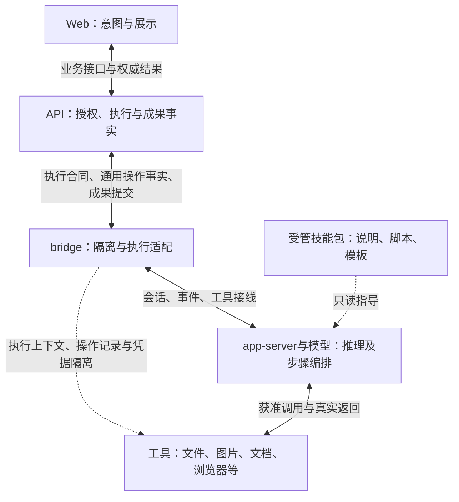
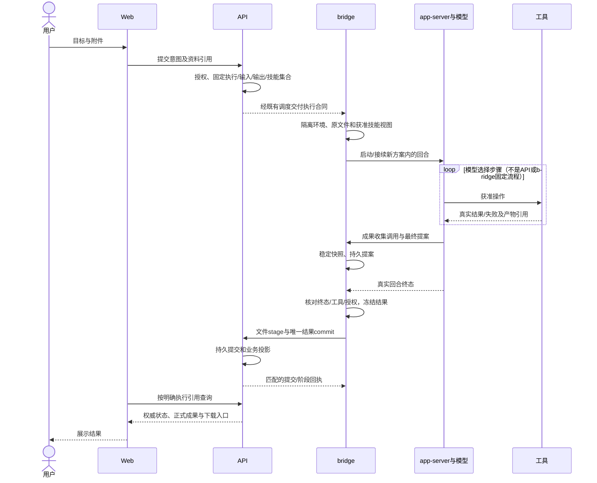
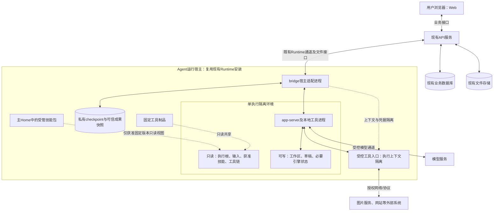

# 原生Agent执行必要4+1视图（v3.1）

> **2026-10-28后续用户决定：**以[RB-1“技能原生调用与用户自配凭据”](responsibility-boundaries.md#2026-10-28-用户更新技能原生调用与用户自配凭据)为准。生图/改图改由app-server原生运行技能脚本，后续支持用户为已安装技能单独配置密钥。下文与图中“bridge专用Provider工具出口/专用图片授权接线”的旧目标不再实施，相关实施明细待按本决定收口；通用隔离、任务权限、真实成果提交和未知事实保护继续保留。此更新不是源码迁移完成或上线证明。

日期：2026-10-28（Asia/Shanghai）。Owner：本聊天，任务CODEX-NATIVE-SKILLS-20261027。
状态：**目标架构视图，不是已实现/部署拓扑**。以[RB-1职责规格](responsibility-boundaries.md)、[核心详设v3.1](native-execution-technical-design-20261027.md)、[扩展详设v3.1](native-execution-extensions-20261028.md)为准。沿用其固定源码/范围，不新增服务、框架或部署单元。

只保留五个必要视图：逻辑（谁负责）、开发（代码放哪里）、运行（如何协作）、部署（运行在哪及隔离边界）、场景（如何证明）。图中名称是职责/交互概念，不预定尚未实现的DTO、进程数量或wire方法。

## 1. 逻辑视图：职责与权威

| 责任 | 唯一权威/持有者 | 禁止跨界 |
| --- | --- | --- |
| 用户/资料/任务授权，执行接纳，正式成果完成 | API | 模型、bridge、Web不能自授权或自行宣布业务完成 |
| 执行隔离、材料/技能视图、引擎接线、候选快照和回传 | bridge | 不按技能名/Provider品牌编排整个任务 |
| 具体步骤、工具选择、脚本和结果提案 | 模型；app-server承载实际回合/调用 | 不把提示或包声明当权限，不绕受控操作记录 |
| 具体协议/文件处理及真实外部操作结果 | 工具适配 | 不另建业务状态机或平台授权体系 |
| 可复用经验 | 技能包 | 不是执行器、权限或基础文件能力的前置条件 |
| 用户交互和呈现 | Web | 不从模型文本或“最新文件”猜成果归属 |

API业务事实、bridge恢复checkpoint、引擎事件、外部工具事实各有归属，并非四套重复业务状态机。技能安装管理仍归API，包实体和实际能力测量归Runtime；包的内容不是另一个服务。任务委派和Agent身份分别绑定，允许合法跨Owner委派，不要求两者同Owner。

## 2. 开发视图：代码组织与依赖

下表为现有仓库/文件中的目标职责，不要求拆成同数量的新模块或改目录。跨仓连线通过合同，不是互相导入内部实现。

| 代码位置 | 放什么 | 不放什么 |
| --- | --- | --- |
| `/home/isp/wsps/cyf/web/src/composables/juyiting/` | hallSkillResults/useHallSkillResults的明确执行关联与状态读取，bountyOutputCatalog通用成果展示 | 任务编排、业务完成推断、Provider分支 |
| `/home/isp/wsps/cyf/api/agent/` | 既有执行、lease、通用操作事实、stage/commit、安装/版本管理 | Home管理、脚本执行、Provider请求/轮询 |
| `/home/isp/wsps/cyf/api/chat/` | 会话/请求/执行关系、材料访问和成果投影/查询 | 为每个技能新增动作路由或重演模型步骤 |
| `/home/isp/wsps/chcbz/isp-install/conf/codex-bridge/` | 通用执行入口、app-server适配、隔离环境、文件交付、私有checkpoint与成果回传 | 固定图片/视频流程、强制单技能/商品、旧runner兜底 |
| 同Runtime制品内的工具适配/固定工具链 | 图片Provider编解码、文档库、浏览器、FFmpeg等具体能力 | 独立账户/权限/任务系统；核心反向依赖某业务工具 |
| 既有受管技能包 | SKILL.md及实际需要的脚本/模板/依赖说明 | 强制新增“原生配方runner”、宿主秘密 |

依赖约束：

- API和Web依赖已明确的公共/业务合同，不依赖Provider内部协议或Codex进程细节。
- bridge通用执行依赖引擎适配、文件/操作/成果接口；具体工具通过注册/绑定接入。组装入口可以接线工具，不能把工具选择与业务步骤写死在核心。
- 工具复用通用执行上下文、凭据引用和操作记录，不能直接修改API业务表或跳过提交发布成果。
- 普通新增技能只变包/安装记录；新增依赖变工具制品；新Provider协议变工具适配。只有真实新增授权/恢复/交互语义才变对应合同。
- E1–E6使用核心。核心不依赖视频制作或技能提取工作流；本地视频不依赖云服务，文本技能提取不依赖视频。

旧入口及历史执行恢复代码按核心§16删除，不留兼容执行器。历史已提交成果只读不是执行依赖。

## 3. 运行视图：一次执行的协作

- `artifact.stage`/`result.propose`为拟接入的成果工具，归bridge的通用收集/提案处理，不是模型直接写业务数据库；实际transport名称由固定schema落实。
- 普通本地文件/命令由引擎在隔离范围执行，不要求每条shell回调bridge审批。受保护外部操作通过绑定上下文和通用持久操作记录，在发出前记录身份/意图，结果真实落盘后确认；秘密不进入模型。
- API→bridge表示经现有调度交付，不新增直推服务或调度器。多个执行可并行且工作区独立；同执行通过现有lease/fence和锁确保唯一有效提交者。
- 模型终态 ≠ 工具产物 ≠ API正式完成。ARCHIVING不展示为全部成果已可用，用户验收/结算仍是既有独立业务。

**仅新方案恢复：**上传/commit回执丢失，查原执行、原outputId/manifest并复用已生成字节；外部结果未知，核查原操作，不换ID重发；回合终态丢失，核对原回合，不从文件存在推断完成。这里不恢复切换前的旧协议执行。

## 4. 部署视图：最小运行单元和隔离边界

部署约束：

- Web、API、Runtime复用现有部署单元。图中的框是职责/信任域，不要求各占一台机器、一个微服务或一个常驻进程；工具按需以现有适配/MCP接线，浏览器会话单独隔离。
- Runtime目标应用实体仍为 `/home/isp/apps/cyf-agent-runtime-v1/app/`，内部为runtime、codex-bridge及固定工具链；不新增版本目录/current链接。这是既有项目路径要求，不是本轮线上核验。
- 每个执行绑定有独立必要状态；不是每条消息复制Home/工具链。同一新方案执行的后续步骤和恢复使用原绑定。
- `/execution`为bridge控制的只读中性cwd；`/inputs`与获准skills只读；`/workspace`、草稿`/outputs`可写。宿主可信快照库不挂给模型。
- 主Home的auth、全量配置、其他任务和未授权技能不挂载；仅按固定版本交付获准包。不能以普通软链接代替隔离/只读保护。
- 模型调用和工具外网走各自受控通道；本地命令无任意外网。浏览器登录态/Provider秘密不进入模型可读目录，网页自身的网络访问也受工具边界控制。
- 具体引擎版本、schema、MCP字段与依赖版本仍需按候选验证。图不宣称当前引擎或线上已经满足。

## 5. “+1”场景视图：用最少场景验证架构

| 场景 | 穿过哪些职责 | 必须证明 | 对应验收 |
| --- | --- | --- | --- |
| S1 无技能读TXT并生成文件 | Web→API→bridge→模型/文件工具→成果提交 | 不造技能/商品，不由宿主JSON代写冒充原生；文件真实可下载 | RB-A01/A04/A05 |
| S2 模型连续生图、改图并选择成果 | 模型编排，图片工具执行，bridge记录操作/交付 | API/bridge没有固定业务步骤；一次重送不变成第二次外部调用 | RB-A03/A06/A09 |
| S3 读取网页、下载资料并生成文档 | 浏览器工具→派生材料→文档工具→通用成果 | 来源/权限不越界；前后端不懂网页步骤或Office算法；无预览仍可下载 | RB-A03/A07/A09 |
| S4 新方案上传或提交响应丢失 | bridge checkpoint↔API持久事实 | 只查/重传原结果，不重新生成；Web归档中不假完成 | RB-A05/A06 |
| S5 单轨切换遇到旧未完成执行 | API停止旧调度，Runtime/Web旧恢复入口移除 | 不续跑、不补传/提交、不自动转新任务；迟到旧回执不复活；旧正式成果只读 | RB-A04/A08 |
| S6 提取经验并在新任务使用（扩展） | API固定来源→模型提取→包管理→新执行 | 不新增提取runner；普通新技能只变包；新任务重新绑定权限，缺源不伪补 | RB-A02/A10/A11 |

S1–S5覆盖核心及已要求能力的关键边界；S6属于E6扩展，不作为核心执行前置。网页/图片操作成功均须真实证据，模拟只能验证相应局部合同。

## 6. 视图的使用边界

- 此五视图是v3.1的导航表达，不新设任务状态、服务或数据库表；实现以职责规格和详设的精确合同为准。
- 不保留旧协议/旧runner执行与恢复；新方案自身故障恢复保留。历史资料/备份不随代码退役删除；旧UNKNOWN不伪造终态。
- 视图/文档检查通过不证明功能完成。产品开发、删除、候选测试、安装和线上验证分别记录，正式必要验证沿根AGENTS本地固定源码规则。
