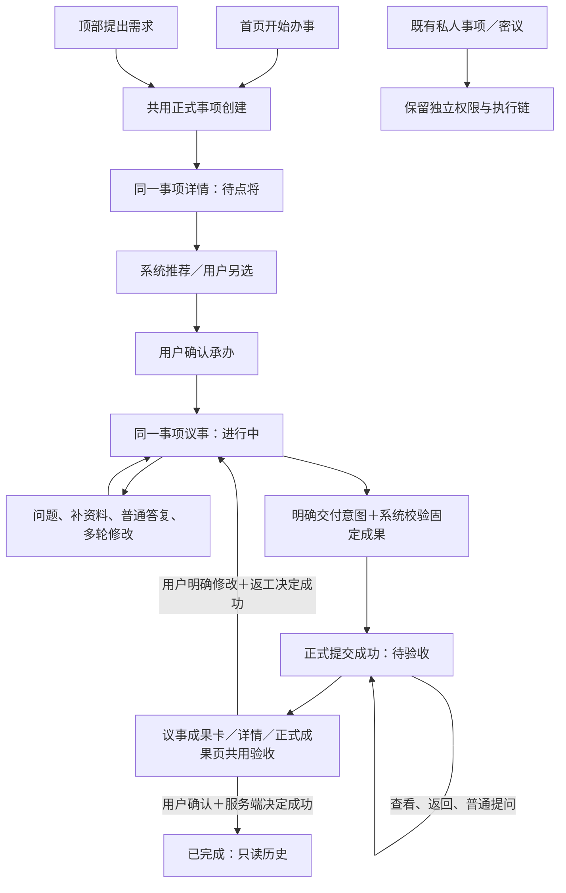
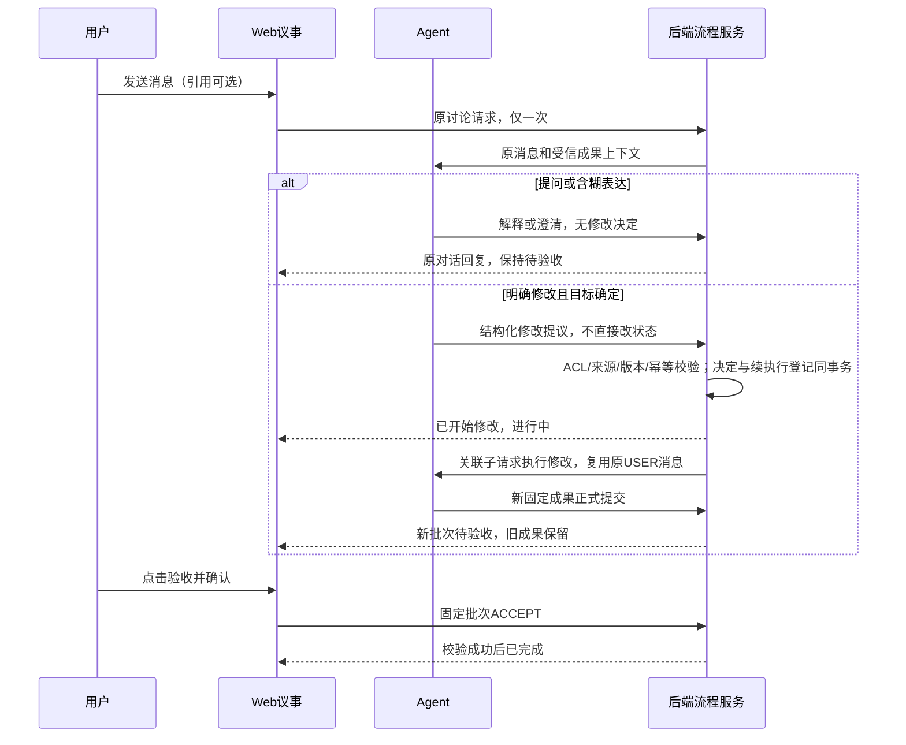

# 聚义厅体验优化详细设计

> 2026-10-23整理：本文保留原日期源码/设计定位，不按旧排期执行、不从“待实现”文字推断当前代码。当前范围与交互见 [spec.md](spec.md)，剩余工作见 [tasks.md](tasks.md)，后续成果多选及历史稿验收见 [最新详设](../../juyiting-external-commission-mvp/design.md#selected-output-acceptance)。发布/验收独立查证。

> 2026-10-18代码级补充：[后端/合同/持久化](code-backend-design.md)、[Web逐文件交互](code-frontend-design.md)、[代码实施与测试清单](code-execution-checklist.md)。下文10月17日的“待收口”事项已在这些文档中给出目标方法/合同；E01现在是按设计实现codec/schema与验证，不再重新选择架构。新增设计不代表现行接口。

初始日期：2026-10-17；本轮界面/源码复核：2026-10-18。Owner：当前任务负责人（沿用 `REQUIREMENT-EXECUTION-20261016` handoff）。状态：**实施设计，尚未实现/验收/发布**。

关联：[完整变更方案](spec.md)、[执行计划](tasks.md)、[生产全流程核对](full-flow-recheck.md)。页面、卡片、控件的唯一最新规格在 `web/prototypes/juyiting/specs/prototype-spec.md`（仓库根相对路径）；本文件描述本次如何改，不复制第二套原型规格。

## 1. 基线、范围与设计边界

- 依据2026-10-17已完成的生产观察和授权写链；正式事项466文本创建、点将、多轮修改、人工验收及完成回读通过。顶部私人入口在最后观察时仍QUEUED，不能据此认定永久卡死。
- 本次文档整理本地HEAD仍为根 `aae93c074960580942112707e9518d831a0ff0af`、Web `6fbdb6618b1132316a95db87cca9402de83138e8`、API `b76a1d0aeda572767a6d4734d050121d985bd9c9`；tree及此前fetch记录见 `baseline.json`。本次未重新fetch、登录生产或运行应用，不将这份文档日期当新线上核验。
- 19页纳入范围：9页明确改动、8页共享复核、2页证据不足；追踪变更方案A01–A09/B01–B08。
- 正式事项仅单承办、一个必需工作项；多成果文件不等于多Agent聚合。身份、资料可见范围、计费、租约及终态约束沿用服务端权威。
- 不做无Agent注册引导、账户系统、公议新入口、旧私人数据批量迁移、Runtime接入重构或新取消/退款能力。
- 接口标准固定为 `api/docs/interface-standard.md` **v1.2（2026-10-14）**。下文逻辑字段不是已上线DTO声明；新增/变更wire须补既有接口目录与schema，全部实际生产者/消费者同步，禁止长期双轨。

## 2. 整体结构与责任

| 层 | 责任 | 不允许承担的责任 |
|---|---|---|
| 页面/共享控件 | 表达真实阶段、草稿/预览/选择、明确操作意图 | 凭消息结束、文件数量或计时器修改业务状态 |
| Web composable | 同一事项上下文、请求关联、取消过期观察、共用投影/决定入口 | 用上次Agent、其他话头回执、字符串文案推断权限 |
| API业务服务 | 创建、指派、提交、决定、返工的权限/版本/幂等和事务 | 将用户普通聊天当验收；公开旧私人数据 |
| Agent/执行服务 | 已授权请求执行、明确交付候选及固定来源 | 自行代用户通过验收；绕过必需工作与有效租约 |
| 读模型 | 根事项＋当前交付＋未决操作的关联事实和合法动作 | 将请求完成等同于事项完成 |

## 3. 用户状态投影（B03）

四主阶段仅为投影，不新增一套持久业务状态机。归一化投影由共享逻辑生成，首页、列表、详情、议事、消息聚合共用；API仍裁定每次写入。优先级：**权限/数据完整性 → 原操作未决限制 → 根终态 → 当前有效交付 → 指派/执行事实**。未决限制是覆盖提示，不伪造新的主阶段。

| 权威事实 | 用户显示 | 合法操作/限制 |
|---|---|---|
| 尚未创建，仅有本地或服务端草稿 | 草稿，不进四主阶段计数 | 编辑、保存、开始办事；创建未知先查原意图 |
| 已保存、无有效指派 | 待点将 | 推荐/另选/确认；取消仅按资格 |
| 已指派未接手、排队或执行中 | 进行中＋真实原因 | 继续议事；不新增“待开工”主标签 |
| 待澄清、等待授权、可恢复阻塞 | 进行中＋问题/原因 | 同议事回答或实际允许的恢复；不自动重试 |
| 当前有效正式提交、未决定、无已成功返工 | 待验收 | 查看成果并验收、继续议事；后者只导航 |
| 旧提交已要求修改，新轮次尚无有效交付 | 进行中 | 同议事修改，旧成果保留历史但无验收入口 |
| 根完成且决定/交付关联有效 | 已完成 | 最终成果、历史议事只读 |
| 根failed / cancelled / archived | 失败／已取消／已归档的历史标记 | 次级历史/异常可查回；不混入四主阶段，不默认可恢复 |
| 创建/提交/验收/返工回执UNKNOWN | 保留最后已确认阶段＋“正在核对本次操作” | 冻结冲突写入，查询同一操作；不更换幂等键重发 |
| 未知枚举、来源缺失、根与交付矛盾 | 状态待核对及安全说明 | 保留已知事实，只读/刷新，不落入默认进行中 |
| 401/403或身份切换 | 登录/无权访问提示 | 隔离缓存和订阅；不得用旧数据继续操作 |

筛选和计数以同一权限域及查询语义计算，不以当前分页条数代替总数。无权限数据不展示；可见但事实冲突的记录不能悄悄消失，留核对入口。归档标记若是个人整理而非根终态，仅影响个人视图，不覆盖正式阶段。

### 状态转换与触发

| 转换 | 触发者 | 成功条件与失败行为 |
|---|---|---|
| 草稿→待点将 | 用户点开始办事；API保存 | 原子保存需求/资料引用；成功取同一taskId，未知查询原创建意图 |
| 待点将→进行中 | 用户确认Agent；系统接续首轮 | 权限、候选、事项版本有效且指派持久化；派发失败在原事项恢复，不重建 |
| 进行中→待验收 | Agent明确交付；系统提交 | 固定来源/版本、有效权限和必需工作项、无未决修改冲突；提交失败保留普通成果及错误 |
| 待验收→进行中 | 用户发送明确修改意图 | 对当前交付的要求修改决定成功；新执行失败仍保留决定和待恢复原因，不能恢复旧验收按钮 |
| 待验收→已完成 | 用户点击确认验收 | 服务端决定与完成事实成功；未知保留核对，不能前端先完成 |
| 可取消阶段→取消历史 | 用户取消 | 仅真实允许动作成功，不代表Provider停止或已退款 |

## 4. 创建、指派与议事连续性（B01/B02/B04）

1. 首页与顶部编辑器复用 `useHallRequirementCreate` 的正式创建服务。标题/正文/固定资料引用进入同一意图；保存草稿不调用Agent，开始办事才创建正式事项。
2. 顶部入口不再为**新正式需求**默认走PRIVATE_CASE。旧私人草稿/事项保持原入口与原scope；用户打开历史记录按来源分流，不静默改成TASK或改变可见范围。已有草稿提交策略在合同收口时显式定义，不把尚未提交的私人草稿自动公开。
3. 创建成功立即进入同一详情待点将；推荐请求失败不影响已保存事实。选择候选只更新选择，用户确认才调用既有point-and-deliberate链；费用/授权确认如实际需要仍保留，不能以少分支为由绕过。
4. 确认时绑定taskId、当前指派/事项版本和显式Agent ID；取消推荐或返回不撤销事项。无Agent时显示真实空态与已有名册入口，不扩建新手流程。
5. 话头属于事项/Agent作用域，新话头不新建事项。草稿按身份＋scope＋事项/Agent＋话头隔离；发送成功才清草稿，失败保留。
6. 澄清回答沿pendingQuestion与版本关联；普通提问不拒收。不提供“引用修改”按钮；修改直接在议事输入。发送明确修改要求由Agent提议，后端从原消息快照绑定固定交付；模糊自然语言先在同议事澄清，不由关键词猜测执行破坏性决定。
7. 话头切换不丢交付入口：若当前话头无对应消息，展示同一权威交付集合的紧凑引用卡，仍一个批次一个入口，不复制或重新提交交付。

## 5. 正式提交、验收与返工（B05/B06）

### 5.1 现有能力与拟改合同

现行 `ChatSelectedOutputFinalizationService` 在人工点击后submit→accept，生产已验证；这是已有的一键验收，不是稳定待验收。目标是将准备/正式提交和用户决定解耦，不能只把按钮移进聊天。

| 业务动作 | 现有落点（2026-10-17定向源码） | 本次设计 |
|---|---|---|
| 正式提交/列表 | `AgentTaskFormalDeliveryController` 的 `/agent/tasks/{taskId}/formal-deliveries` POST/GET | 复用正式交付服务；自动提交由受信服务编排，不让浏览器伪造leaseToken |
| 决定 | `.../formal-deliveries/{deliveryId}/decision` POST | 复用验收/要求修改事务，所有UI入口调用同一决定入口 |
| 返工执行 | `.../formal-deliveries/{deliveryId}/rework-executions` POST | 关联已成功修改决定与原话头，保持原版本链，可恢复创建失败 |
| 选中聊天成果编排 | `/agent/tasks/{taskId}/finalizations`、`ChatSelectedOutputFinalizationService` | 拆除提交后无独立决定的自动接续；保留固定文本转成果、原操作核对及恢复能力 |
| Web成果入口 | `BountyDiscussionPanel`、`BountyAcceptancePanel`、`BountyExecutionOutputs`、`bountyOutputCatalog` | 共用固定成果目录和决定动作；不按页面各造验收服务 |

以上路径为现有路径定位，**不是新wire已冻结**。最终finalization提交语义、操作查询DTO、Agent交付事件承接点已由2026-10-18代码级后端详设B2–B5确定；E01按其补入既有接口目录、codec和测试；不创建猜测URL或复用旧“确认”接口自动通过。受信提交不得借用用户验收权限冒充Agent租约。

### 5.2 固定批次与操作输入

需验证的逻辑关联：认证tenant/client/owner、taskId/expectedTaskVersion、指派版本、workItem/run与有效执行授权、conversation/request/message固定来源、artifactId/artifactVersion/contentHash、deliveryId/expectedDeliveryVersion、决定版本及幂等意图。字段名称以既有DTO为准，缺少的才设计扩展；认证主体不能信任body。

- 文本必须固化所选消息版本及替换链，不能以“最后一条消息”动态求值；文件必须固定版本与摘要。REPLACE关系保留旧历史，不覆盖已经验收的批次。
- 自动提交触发为权威交付意图成功落库后的服务编排；普通回复、单个媒体上传、request completed均不触发。重投按同一来源/版本去重。
- 提交成功后必须可刷新读到submitted/current delivery，且没有用户决定时不会进入ACCEPTED/completed。只读访问不创建交付。
- 验收确认冻结整个批次及版本；预览仅打开文件，不更换冻结集合。确认前后都重新检查权限、当前批次、必需工作项与根终态。
- 同一批次并发验收与修改仅允许一个胜出；版本冲突刷新权威事实，不自动改成对新批次的决定。重复同一意图返回原结果；同键不同载荷不得当新请求。
- 交付已要求修改但返工执行未成功：保留决定与恢复点，只恢复同一返工意图；不能再接受旧交付，也不能向用户提示新轮次已执行。
- 返工产生新固定批次，再进入待验收。此前普通聊天修改成功不算本轮“拒收→返工→重验”验收证据。

### 5.3 用户界面

- 详情待验收仅“查看成果并验收 / 继续议事”。查看进入同一交付确认；继续议事只导航。
- 议事不增加固定待验收大区域，顶部事项操作栏提供唯一“查看并验收”入口，范围是整批，仅资格满足时显示。消息区与所有单文件成果卡无验收按钮；弹窗显示本批数量和全部成果，二次确认后提交。
- 成果卡只保留预览，验收不属于单条消息或文件卡；移除卡片下载/保存到工作空间，但保留独立预览/资料下载及文字片段保存。
- 独立正式成果页保留历史和异常核对，共用决定合同。完成后展示最终成果或真实读取失败，不同时提示“等待结果”。

## 6. 页面与共享组件实施设计（A01–A09）

详细尺寸/token以最新规格第2–4节为准，产品用有作用域的token与共享组件，不整份搬运原型CSS/JS。主题暖白、朱红主操作、中性次操作；阅读与地图保留场景主题。

| 页面/组件组 | 实施要点 | 必须保留/验证 |
|---|---|---|
| P01/P03：首页/编辑器 | 共用创建意图；首页无Agent选择器；成功承接同一详情 | 输入与资料、草稿、失败/未知恢复；不复制样例数据 |
| P02/P04：事项/详情 | 共享投影、五筛选单行横滚无新增统计行、同源计数、内联推荐/另选、状态对应主次动作 | reviewing漏映射、失败/取消/归档历史、真实allowedActions |
| P05：点将册 | 复用现有PC分栏/手机详情，固定底部操作 | 技能加载/失败/未核验不可显示旧就绪；迟到响应隔离 |
| P06/P07：正式/私人议事 | 全屏消息优先；正式输入区紧凑并去重复上下文、终态隐藏；工具栏图标统一尺寸；录音/转写在输入框内 | 私人无正式验收；技能折叠条、语音设置、话头分页/删除确认 |
| C08/C09：选材/预览 | PC默认分栏预览无切换图标；移动同按钮预览/收起；已选区独立限高滚动 | contain图片、PDF分页与返回选材、选择暂存、取消不提交、下载明显 |
| C06/C11：输入/录音 | 紧凑附件条目，不铺大图；取消录音恢复草稿；转写可编辑且不自动发送 | 键盘/低高度消息可见；空转写不覆盖，权限/错误可恢复 |
| C07/C10/P19：成果/验收 | 顶部批次验收图标、确认冻结、返回议事仅关闭弹窗不改变草稿/决定 | 多媒体、旧版本、未知操作、完成只读；正式历史不删除 |
| P09/P10：资料/详情 | 共用文件控件/主题，版本固定引用 | 上传新版本、回收/恢复、独立下载，禁止借卡片精简删除管理功能 |
| P11/P12/P13/P14/P15/P16/P17 | 共用导航/反馈，帮助改四步；消息保持待处理聚合 | 阅读目录/手札/书签/引用、完整名册招募、地图真实交互，无隐式已读 |
| P08/P18 | 先确认公议入口，账户保持已证实不可用边界 | 不按原型示例补造线上功能 |

导航遵守同页头返回/×二选一；无返回独立弹窗保留统一关闭，Escape只退顶层并还原焦点。移动选材预览返回先收起，第二次才退出；完成才写入附件草稿。触控基准44px，焦点/hover不丢文字对比，不仅靠颜色说明状态。检查1440/390/320以及生产实际断点两侧，不机械用原型720px覆盖生产所有断点。

## 7. 恢复、隔离和数据策略（B07/B08）

- UNKNOWN是传输/操作认知状态，不是失败或可以新键重试的依据。记录原operation/意图，刷新按原操作恢复，成功读回才更新阶段。保留失败和无权限的区别。
- 响应合并校验身份、scope、task、execution/operation和版本；切换身份取消客户端观察但不宣称后台取消。过期响应不能覆盖当前Agent/事项。
- 旧PRIVATE记录保留原访问和ACL；本次仅统一新正式入口。旧队列问题独立查Runtime接收/回执/输出证据，不以QUEUED推断唯一根因，也不以改文案掩盖未闭环。
- 不预设DDL或批量迁移。优先复用已有交付、决定、执行和操作存储；若稳定提交需要持久恢复点，E01先做schema差异与恢复设计，再明确增量迁移、备份和回退边界。无证据不能写“无需迁移”。
- 已完成/取消及其他终态不通过重新开页、引用或新话头绕过写保护。个人整理不等于归档，取消不等于停止Provider/退款。

## 8. 设计收口项与验收边界

| 待收口项 | 必须得到的产物 | 阻塞范围 |
|---|---|---|
| finalization拆分、自动交付承接点与恢复查询 | 既有接口目录/schema、权限/租约/幂等与事务设计、生产者消费者清单 | B05/B06及新验收入口产品接线 |
| 根阶段/交付/个人归档冲突投影 | 固定fixture全表、跨页计数和安全回退测试 | B03全量切换 |
| 明确修改意图传递及决定→返工恢复 | 明确意图参数/既有字段对应、歧义交互、并发测试 | 正式拒收与返工 |
| 当前原型缺项 | P19、历史终态、PDF、技能条、文件版本、消息聚合等补齐 | 对应产品界面实施 |
| 公议/账户/旧PRIVATE队列根因 | 实际入口或边界证据/独立定位结果 | 只阻塞对应功能，不阻塞已知共享控件 |

上表为10月17日的合同收口清单；主链具体设计已在代码级详设中落定，现场入口/生产安装事实仍需验证。不增加额外人工审批，也不将目标设计当作实现事实。执行测试矩阵和完成定义见执行计划。

## 2026-10-18 已确认：议事自然语言修改与控制边界

直接说出明确修改要求即可；移除“引用修改”按钮，多成果通过名称/内容及对话澄清定位。普通提问/赞同保持待验收，含糊表达在原议事澄清。不得把引用、关键词或“可以”当作正式决定。验收仍须用户点击并确认。

职责：用户作决定；Agent理解并提出结构化修改请求；后端核验来源消息、ACL、批次/版本、幂等及事务并控制状态；前端呈现回执、不自行切换状态。后端不能消除全部语义误判，语义不确定时不执行返工。

流转：待验收 →（正式修改与续执行登记提交成功）进行中 →（新成果正式提交）待验收 →（用户明确验收）已完成。普通问答/澄清不改变待验收。历史成果保留，多成果指代不清时先问清目标。

实施以code-backend-design.md B4.1、code-frontend-design.md F4为准；自然语言发送一次，复用原USER消息并创建关联子request，不重开父request、不重复发送正文。验收与修改并发以固定批次版本校验，未知结果查询原操作。此为目标设计/离线演示，不表示产品或生产已实现。

## 2026-10-18 源码推演修正入口

详见[source-design-review.md](source-design-review.md)：10项缺口及R01–R10源码依据，v5三端协议、不可变父请求＋关联子执行、来源快照、待验收执行门控、恢复/版本/前端上下文等修正已并入代码级详设。此为目标设计，不是生产已实现。

执行顺序调整：C01先做V01 Runtime→Java→Web严格合同探针；C04先做V02真实DB事务和单消息子执行，再以V03文本“提交→修改→再提交→验收”打通垂直闭环；通过后再扩多成果/19页。新增Runtime为本链必需参与组件，不放到仅排查旧私人链的C09。V04–V06并发/恢复/成果/前端反例按复核文档补充。正式验证仍走项目Flow；Runtime源码/流程单独固定并遵循其仓库规则，不借本次审查授权发布。

## 2026-10-18 实页对照后的设计约束

见[page-prototype-recheck.md](page-prototype-recheck.md)逐页矩阵及U01–U10。这些是C00必须先补的原型表达，不是增加业务状态：
- 议事与独立成果页共用同一固定批次复核/确认；返回议事仅导航，不自动拒收。验收决定针对整个固定批次，唯一议事入口在顶部事项操作栏，禁止放入消息区或文件卡。
- 四主阶段之外保留异常/归档检索；任务技能条、PDF分页、文件版本管理、完整招贤、真实多事项消息不能按简化示例删除。
- 首页/列表/详情/议事/成果/消息统一同一投影；生产列表待验收/详情已受理是复现差异，不可沿用。帮助必须包含人工验收。
- 公共议事入口未核实；账户仅禁用入口。全屏和暖色统一是目标，地图/阅读专有主题不强制抹平。
本轮只读页面检查，未重跑业务写链，不改变V01–V03优先验证及历史证据边界。

## 2026-10-18 原型补缺已落地

[原型修正与复查](prototype-fix-recheck.md)记录U01–U10在现原型中的实现及精确输入检查。前节“待补原型”是实页核对时结论，本轮已补离线表达；产品前后端/Runtime实现、生产状态不一致及V01–V03仍未完成，不把原型通过作为C01–C09完成证据。

### 2026-10-18 顶部验收图标样式（最新）

顶部“查看并验收”采用与刷新/话头操作一致的线性清单勾选图标，替代红底文字按钮：44×44px触控区域、20px图标、透明背景、正文色，hover浅底、键盘focus可见轮廓，title及aria-label为“查看并验收”。替代此前88px文字按钮规格；仅更换入口样式，原资格、全批查看、确认验收及异常核对不变，不能点击图标就直接完成事项。产品尚未实施。

## 10. 2026-10-18 最新界面决定收口

- 事项：五个筛选同排，窄屏左右滚动，无新增统计行；加载/计数失败反馈保留。
- 议事：全屏消息区优先占用空间；正式输入区不重复事项/承办人，计数进工具栏；44px输入区内部滚动，完成/取消/归档隐藏禁用输入区，切换活动事项恢复。私人/公议上下文不被全局精简。
- 验收：唯一议事入口在顶部；与刷新/话头/新话头共用44px按钮、20px线性图标及1.8线宽、统一gap，无红底和额外边距；title/aria-label可识别。消息和单文件卡只预览，点击图标打开全批复核，确认后才提交；自然语言修改不变。
- 原型资源版本同步，普通刷新保留草稿。页面内容哈希更新不等于服务端合同或生产已上线。
- 逐文件props/slot、自动输入高度冲突、终态语音清理、条件取消按钮、多Agent可操作chip见前端详设F8。条件取消在2026-10-19按输入区“停止本轮回复”方案补原型（覆盖旧第五图标方案）；多Agent可操作chip仍须补样例验证，不能声称生产能力全覆盖。

### 2026-10-19 停止本轮回复复核结论
生产实测两次取消均发生stateVersion冲突（409），随后自然完成，不视为停止成功。前端详设新增版本/SSE闭包、409只读核对、错误可见性及终态幂等处理要求。正式退出条件必须包含真实CANCELLED→继续发送，当前未满足；UI原型通过与生产功能通过分开记录。

### 2026-10-19 停止链路修复验证进度（非上线）

后端`5aa8efc2462cd0dc1dce531bdbfccaa5cae390c6`（Flow5260799/155）、前端`7b0d2be8feb34a366403d7d728a91be625a42166`（Flow4403172/227）正式验证通过并以受测提交集成develop。后端2397次执行：2302通过、95跳过；前端3049通过、2pending。修复权威turn版本传播、409/未知只读核对、重复取消及终态发送锁恢复，不改变事项状态、不降低并发版本校验。

详细证据与失败归因见[停止链路修复核验](../evidence/reply-stop-fix-20261019/verification.md)。临时流水线配置已恢复并readback；**未部署生产**。此处只更新已核验实现范围：生产仍待吴用真实停止→CANCELLED→下一轮发送回归；停止图标输入区接线、其他页面优化与整体验收未完成。制品上传成功不等于独立下载校验或上线完成。

### 2026-10-19 输入区停止接线已验证（未上线）

Web `f9e04cbcd70d2678dd3097ffe9cdea3d7b10fbd9` / Flow4403172/229，3053通过、2pending；三个议事入口发送/停止同位、禁用/未知只读、身份隔离的刷新恢复和焦点恢复已实现，9组真实组件浏览器诊断通过。详见[输入区停止核验](../evidence/reply-stop-ui-20261019/verification.md)。上一阶段“输入区仍待接线”仅指旧源码；现候选已集成develop，但**生产发布和吴用真实停止后继续发送仍待完成**，不因此标记整个界面优化结束。后端5aa8efc246/Flow155未变；涉及文件ESLint未清零，制品未独立下载，上线前继续按版本化发布核验。

### 2026-10-19 停止回复专项线上核验补充
API1.16.9（5aa8efc246，Flow5260799/156）与Web1.16.10（bca42d2ea6，Flow4403172/230）已版本化发布并核验同Run制品/安装摘要；浏览器16个已加载资源匹配。吴用密议停止（409权威读回→显式重试→CANCELLED）及下一轮发送通过。此结论仅覆盖停止专项，不覆盖全部原型优化。
正式事项467的两个后续问题均返回“收到。”且界面未展示对应用户消息，根因未定位；正式议事停止/完整验收仍未闭环。另记录长流DELTA_GAP_EXPECTED_318_GOT_319独立问题，停止成功不表示序列问题已修。不得将整体方案标记全部验收通过。
完整证据及下一条源码核对入口：`specs/juyiting-ui-baseline-20261006/evidence/reply-stop-release-20261019/verification.md`（项目根目录相对路径）。此前未发布说明为历史基线，本节仅更新上述专项状态。

### 2026-10-19 发布后异常修正进度
发布后核对已定位两处实现偏差：正式议事混用浏览选择导致回执不接入，以及后端丢弃纯空白delta导致虚假缺口。两处候选已推develop，但正式Flow157/231均无日志失败，未验收/发布。另已确认task467后续输入贯穿持久化、调度和实际引擎均正确，“收到。”是引擎真实输出；提示策略疑点尚须旧/新候选对照，不能认定已修复。
证据与源码基线：`../evidence/reply-followup-diagnosis-20261019/verification.md`。

### 2026-10-19 最新正式验证状态（13:01 CST）
Web59ba8a8 / Flow4403172/232 SUCCESS（3054通过、2pending，构建/扫描成功）。API cd2146f408e692fc58424390e89a40d2f10eb7d2 / tree b757d4cf1b4d3c1b864a2be47106ba0e0b734d56 / Flow5260799/161 SUCCESS（2420项中2325通过、95跳过、0失败/错误；分层检查及fresh bootJar成功）。此前Run159的5项失败已由Run160错误回执定位：旧normalizer误要求requestId/messageId相等，注册被拒绝；已修正两种身份的混用，并覆盖17项normalizer、1项command wire和5组分片回归。不改ACL、运行时证明或序号连续性，不通过改相同ID回避问题。
源码已集成develop，未部署；制品仅有Flow元数据，尚未独立下载验包。Runtime重复回复“收到。”及完整生产议事/验收闭环仍待解决，不标整体方案完成。本次不改变页面/交互，无需另改原型。完整证据：specs/juyiting-ui-baseline-20261006/evidence/reply-followup-diagnosis-20261019/verification.md（项目根相对路径）。

### 2026-10-19 Runtime复测约束（未关闭项）
API cd2146f408/Flow161及Web59ba8a8/Flow232正式CI通过、未发布。Runtime隔离候选f94c254f956f09717711486e8941847ff2bd95c7未合入/安装；80项本地诊断与注入/缺图模型检查通过，但旧、新策略fresh-thread均能回答43。生产task467原thread再次仅回复“收到。”（USER1859218/ASSISTANT1859219），根因未闭环。带同文AGENTS的三轮对照第2轮出现空text合同失败，不标整组通过。
执行顺序：固定原thread与fresh-thread差异证据→针对性修正及重复验证→独立版本化发布→正式议事停止/继续发送/有效成果/人工验收回归。禁止清历史、盲重发、将COMPLETED当业务成功或自动验收。无需新增页面/按钮，原型保留当前简化流程。本轮详设补充见code-backend-design.md B10；完整证据见../evidence/reply-followup-diagnosis-20261019/verification.md。

## 权威上下文与请求投影边界（2026-10-23文档合并）

以下保留原 detailed-design.md D01 的源码级约束（原核对2026-10-19，Web f112b0b2044032d34d0f5a39251f40bbb1b5cbee），不重标当前实现。三端v5/来源快照/不可变父请求与子执行继续见 source-design-review.md 和后端B4/B7；不恢复活动v4/v5双轨。当前成果选择入口以外单详设 selected-output-acceptance 为准，覆盖早期“仅整批/无卡片入口”表述。

### D01. USER显示修复：权威上下文与request投影彻底分工

不再允许实施者在“忽略首次变化”“改flush”“延时刷新”之间自由选方案。采用：**已验证指派绑定持有会话代次；request/目录只能与绑定校验，不能靠展示对象初始化改变安全作用域。**

限定修改位置与职责：

| 文件（相对web） | 函数/区域 | 明确改法 |
| --- | --- | --- |
| src/composables/juyiting/useHallBountyAssignmentContext.js | fingerprint/reset/refresh | fingerprint显式列身份、授权、实际conversationId/taskId/targetAgentId、taskVersion、外部真实失效epoch及enabled，不把activeRequest引用/代次补齐纳入；现有projection作为本模块权威绑定，只能由已校验GET写入。同作用域refresh保留最后可信投影且区分loading/error；授权/真实scope失效立即清除。不得保留跨scope旧投影 |
| src/composables/juyiting/hallBountyAssignmentContext.js | bountyAssignmentContextProjection | 保留严格字段、版本、目标校验。expectedGeneration来自调用前固定的可信上下文，不是来自正在写入的request投影；请求中真实scope改变仍拒绝。不能直接放松generation不匹配校验来让测试通过 |
| src/components/world/JuyiHall.vue | bountyAssignmentContext接线、typedAssignmentRevision、typedConversationGeneration | 确保首轮/历史进入后已有服务端校验绑定；未就绪先复用refresh再发送。两个typed getter读取同一当前绑定，不能各自从activeRequest/catalog/旧pointAndStart拼成不同来源的上下文。pointAndStart仍可辅助定位，但不得绕过当前绑定验证 |
| 同文件 | followupTaskFence、两处同步watch、invalidateFollowupContext | 使用实际conversationTask，而非列表浏览selectedTask；分离“外部scope/相关taskVersion变化”与“绑定首次就绪/同值刷新”。首次就绪和同代补齐不递增失效epoch；真实scope改变或已知权威代次/指派变化时立即失效一次，并重置目录/恢复。统一调度reset/recover，不由两个独立watch重复执行 |
| 同文件 | request/目录更新的接纳边界 | 与当前绑定一致则仅更新投影；不一致则拒绝接纳并标记需重新只读核对，禁止旧流继续写新主体。已有操作捕获的代次/指派版本不可被新值静默替换 |
| src/composables/juyiting/useHallConversation.js | adoptTypedDiscussionReceipt/内容合并 | 保留严格receipt/request/current检查，不用删current解决问题；同代接纳继续服务端内容加载。仅在回归证明这里仍缺合并安全时修改，不顺手重构全部流处理 |
| tests/juyiting-typed-deliberation-page-routing.test.js、juyiting-bounty-assignment-read.test.js、juyiting-bounty-assignment-context.test.js、juyiting-bounty-request-catalog.test.js | 现有测试扩展 | 真正组合页面watch、指派context与目录；初始空request补齐后，projection不被清、isCurrent仍真、正文读取一次、USER可见；再测真实切换仍失效 |

避免新循环的固定要求：外部失效epoch不因projection首次发布而增长；同作用域refresh开始不清projection；不同代次权威响应须先取消旧操作再安装新绑定/允许新发送，不能安装→反向reset→永远丢绑定。scope重置本身造成projection变null不二次触发恢复；恢复仅由当前scope调度一次。服务端版本冲突先刷新权威task/绑定，不重发业务POST。具体回调实现必须用组合红绿测试证明，不靠代码审查假定时序正确。

补充断言：指派GET失败时，本次写操作不得继续使用未核实绑定；保留最后读取投影仅为原作用域只读显示，不等于写授权。退出登录/撤权必须清数据，不能沿用“保留投影”规则。

补充保留原准备稿D02的事件约束：HallDeliveryReviewDialog仅保留 confirm/preview/back，不恢复 revise；allowedActions.REQUEST_CHANGES 是自然修改的业务资格，不映射为新按钮或公共REQUEST_CHANGES POST。D03的三端来源快照、DDL来源列/唯一键/CHECK、既有outbox及锁序以后端B3/B4/B7与source-design-review §3为准，不新增依赖、事件总线、全局Store或公共监听框架。
