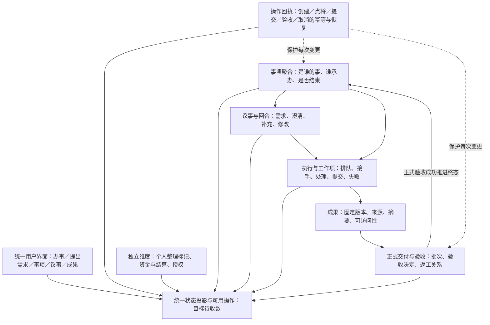
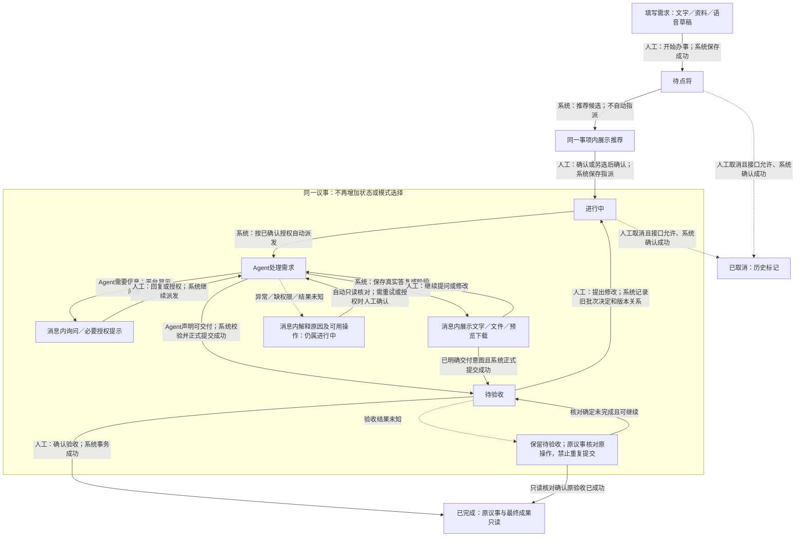
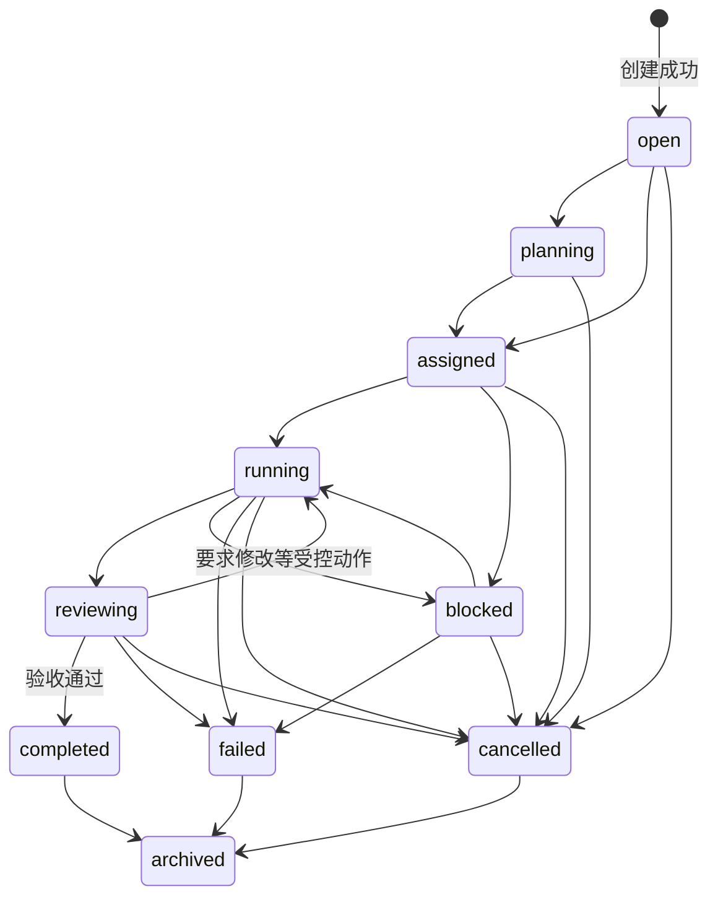
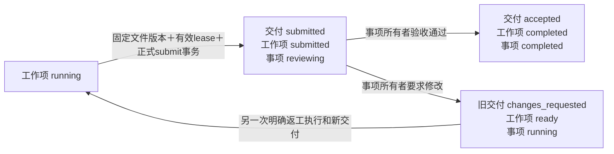
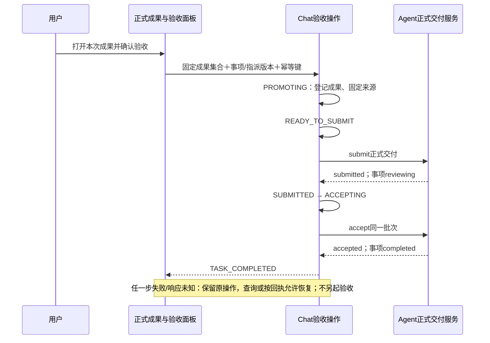
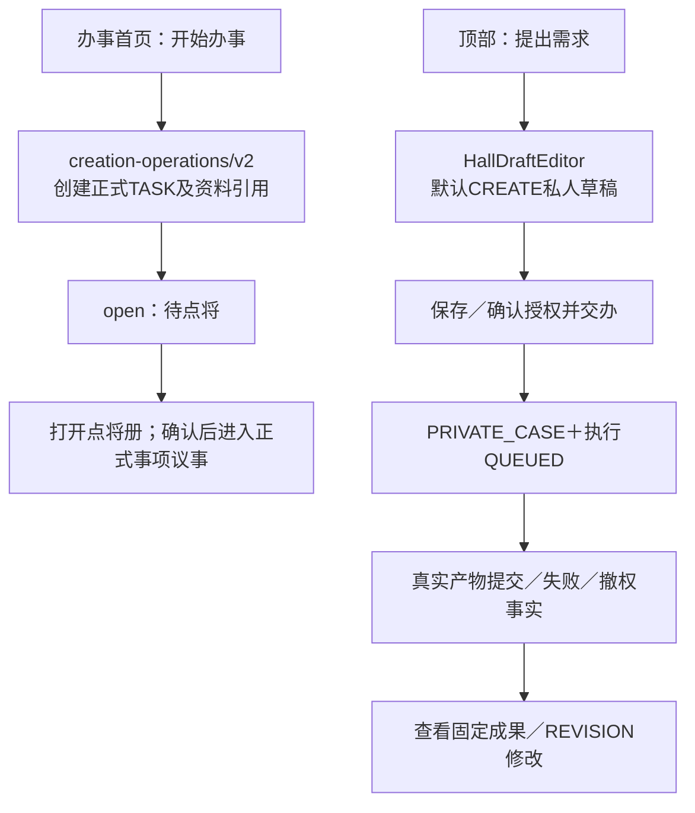

# 聚义厅整体状态流转架构与代码差异

核对日期：2026-10-17（Asia/Shanghai）。Owner：本线程。**这是定向源码审计和目标设计，不是功能已完成/已上线声明。** 本文对“整体”的范围为需求入口到事项收尾的跨端业务闭环，包含现存私人事项、多工作项和资金边界；不声称完成整个项目的逐接口审计。

## 1. 核对基线与结论

以下源码与生产结论保留本日早前审计基线，并非本次原型更新时重新核对线上。第3节为本次四阶段目标及离线原型更新；原型验证时API本地HEAD已为 `b76a1d0aeda572767a6d4734d050121d985bd9c9`，未据此重标旧审计或生产版本。

| 对象 | 本轮基线 | 证据边界 |
|---|---|---|
| 根仓 | `22ff0391cc58a7356550e24c5b11d63dbbeecdd9` | 保留原有脏工作区 |
| Web本地/远端develop | `c84c5a2a279b2a662b4b6b2f1b26c4708317b1ab` | 10:17 +08读取远端；相关业务源文件未修改 |
| API本地HEAD | `c1e97923bf2325e3ada33b7e2816f203630f020d` | 不等于已发布版本 |
| API远端develop | `58b4b5f408257c6d5103d915e13c7927c1571e20` | 10:17 +08读取远端 |
| 生产 | 同线程刚核对Web1.16.4、API1.16.7 | 公网前端资源/已安装API JAR摘要与对应发布记录匹配；详见生产证据。不把本地HEAD当线上 |
| 原型 | 当前工作区 `prototype/interaction-completion.js` | 真实文件SHA见源码索引；fixture，不是后台 |
| 接口规范 | `/home/isp/wsps/cyf/api/docs/interface-standard.md` v1.2，2026-10-14 | 目标公共规范；不因本文定义投影就擅改公共协议 |

**根因不是缺少一个状态，而是不同层次的状态被当成一条流程使用：**

1. 首页新建正式事项，顶部“提出需求”仍进入私人草稿；两者不是同一业务链。
2. 事项根状态、对话回合、执行、成果、正式交付和验收操作，各自都有状态。
3. 列表/详情/首页自行翻译状态；“生成成果”“提交交付”“验收完成”没有统一呈现。
4. 审计时旧原型用“存在结果”推导“待验收”，而生产的 `reviewing` 需要正式提交；两者语义不一致。本次原型已改为固定有效delivery集合模拟正式提交，仍不是实际API。

生产只读例证：事项405「画一只鸟」列表为待验收、详情为已受理，正式成果页确有第1版交付与“验收通过/要求修改”。本轮不重新提交生产验收。

## 2. 分层架构：每一层只回答自己的问题

- **事项完成 ≠ 本轮回复结束 ≠ 文件上传成功 ≠ 工具调用成功。**
- `OUTPUT_COMMITTED` 是执行产物已提交，`RESULT_COMMITTED` 是技能结果已登记；不自动等于正式交付已提交。
- 成果层 `accepted` 与正式交付层 `accepted` 不是同一个事实。
- 创建未知/验收未知是**操作未核实**，不能直接把事项写成失败或完成。
- 已查看/收入案卷是个人整理属性；现有根状态 `archived` 则是另一个正式生命周期事实，不能简单删掉或混用。
- 私人/公共对话可共用组件，但不自动拥有正式事项、公开范围或验收权。

## 3. 完整目标主流程（2026-10-17 用户确认收敛版）

**本节替代先前七状态方案和人工/自动触发表中的中间状态分类。** 用户只需提需求、指定Agent、持续交互、验收；用户可视主状态固定为 **待点将、进行中、待验收、已完成**。取消是次要操作及历史标记，不加入主步骤。“议事”是贯穿办理过程的同一页面，不是业务状态。

### 3.1 主架构图：四阶段、一个议事入口

注意：图中的处理、问题、成果、异常框是**议事内容/动作**，不是筛选状态。失败提示不是“后台正在无限重试”；根已失败或取消不支持时明确说明。图中的异常恢复箭头仅在原事实和真实权限允许继续时成立，不能重开后台终态。

### 3.2 用户状态及人工/自动触发

| 用户主状态 | 进入条件 | 人工动作 | 系统/Agent自动动作 | 不满足条件时 |
|---|---|---|---|---|
| 待点将 | 点击开始办事后，事项及资料引用保存成功 | 确认推荐或另选承办 | 展示匹配候选；不自动指派、不扩大授权 | 保存失败留草稿；无候选保留事项并说明 |
| 进行中 | 用户确认承办，指派保存成功 | 在同一议事提问、补充、授权、修改 | 在授权内派发、处理、提出问题、保存及展示成果 | 等接手、缺信息、缺权限、失败或未知都在议事解释，不增加主状态 |
| 待验收 | 明确交付目标的固定成果正式提交成功 | 查看并明确验收，或直接提出修改 | 展示成果与验收入口；**不自动通过** | 交付未成功不能标待验收；验收未知保留阶段并核对原操作 |
| 已完成 | 用户明确验收，服务端确认成功；或查询确认原验收已成功 | 查看历史成果 | 固定最终版本，当前事项只读 | 没有成功事实不显示完成 |

**进行中是事项尚在协作办理，不代表Agent此刻一直计算。** 具体情况在议事消息/紧凑提示中说清，不用新状态教育用户。待验收中的修改请求被受理后回到进行中；仅打开修改输入框不改变状态，未发送的草稿也不改变已提交成果。

### 3.3 系统内部仍需保留的规则

1. 草稿 → 创建操作 → 事项：人工开始办事；原子持久化成功才待点将。创建未知先查原操作，不重复新建。
2. 指派 → 处理：人工确认Agent；平台核验能力/身份/权限和版本，在已有授权范围自动启动首次处理，不增加“开始执行”步骤。
3. 澄清：Agent提交持久问题，用户在同一议事回复；平台关联原问题及版本。前后都属进行中。
4. 普通答复/阶段成果只展示；**固定delivery集合代表原型中已模拟正式提交的成果**，不能因outputs非空直接显示待验收。无有效交付、悬空成果ID、处理中或回复未核对时不开放验收。
5. 目标自动提交需明确交付意图、有效固定成果、无冲突未决工作；平台验权并保存正式交付后才待验收。原型为fixture，生产自动提交/验收拆分仍未实现，不声称已上线。
6. 用户在待验收发送修改：先记录旧交付要求修改，再关联原版本创建修改轮次；普通聊天不能默认拒收。新成果不覆盖历史版本。
7. 验收必须显式确认；冻结批次/成果集合与幂等键，成功才已完成。未知时不改键重复验收，也不允许冲突修改。
8. 失败、撤权、受阻、未知操作继续保留真实状态及原因，不伪造自动恢复或成功。只能按接口允许的动作恢复；不可恢复的根终态不能从UI绕过。
9. 取消为次操作，仅在真实接口允许且已确认成功时标已取消。运行中取消仍受当前能力限制，不表示Provider已停止/退款。个人收入案卷不验收、不改变办理结果。
10. 私人/公共独立议事不是办事模式选择，也不自动有正式事项验收权；统一新需求入口不公开私人历史数据。

### 3.4 原型落实范围

原有首页、列表、事项详情、议事标题使用同一四状态投影；已取消作为次要历史筛选。澄清/失败/回复未知保持进行中，原提示和恢复动作保留；验收未决保持待验收，原冻结操作、核对入口和写入锁保留。旧会话及草稿不重置，仅将旧展示筛选归并为进行中。

本次不是生产状态枚举迁移，也不删除后台阶段。完整后台事实图和代码差异继续见后文。

## 4. 当前正式事项根状态机（代码事实）

来自S12。这是枚举允许的边，**不代表每条边都有对用户开放的接口**；取消尤其存在更严格限制。

当前没有用户视图“进行中”对应的单一根状态，也没有 `running → assigned` 枚举边。进行中是聚合展示，不能直接让前端把根状态改回assigned。失败为根操作终态；不能画成无条件原事项重新开始。

### 4.1 工作项与正式交付

工作项完整转移表（S13）：

| 当前 | 允许的下一状态 |
|---|---|
| pending | ready / cancelled |
| ready | claimed / cancelled |
| claimed | running / ready / cancelled |
| running | blocked / submitted / failed / cancelled |
| blocked | ready / failed / cancelled |
| submitted | completed / ready / cancelled |
| completed / failed / cancelled | 无 |

正式交付（S14-S16）：

- `changes_requested` 是旧批次的终局决定，新版本需新交付，不原地覆盖旧批次。
- 返工决定已经把根改为running，但工作项只是ready，尚不证明Agent实际开工；用户投影需说明等待返工接手，而非伪报正在处理。
- 当前提交服务明确要求**恰好一个必需工作项**。历史多Agent架构中的“所有必需工作项完成后聚合验收”不是当前这条正式交付实现的能力。

## 5. 当前议事成果一键验收链（代码事实）

S08-S11、S17证明：当前不是“议事产生结果后先稳定待验收、再等待用户确认”。`reviewing` 可以出现在一次验收操作内部。已有独立正式交付则可停留待验收，生产事项405就是后者的实证。

**已实现而应保留：**固定成果集合、版本校验、幂等键、身份范围、原操作恢复、修改关联、终态只读等；不应为了简化UI拆掉这些保护。

## 6. 当前入口与私人链（代码事实）

- S01：`openDefaultRequirementCreate → openPrivateDraft`，不能沿用原型认定两个入口已经合并。
- S03/S04：TASK_CREATE旧草稿恢复仍有分支，PRIVATE和TASK结果校验明确分开。既有历史数据要可读，但不因此建立长期双协议兼容层。
- S20：PRIVATE的 `start` 仅校验并返回STARTED，没有在该分支持久化开工状态。**这是当前源码确认的缺口；不等于本轮证明Runtime仍然拒单或用户原事项现在仍排队。** Runtime端旧报告不能直接当本轮现状。
- S03：`currentExecution` 优先使用旧提交回执，再看最新读取；历史QUEUED快照可能掩盖新结果。需要按同一executionId和服务端版本合并，不是用页面当前对象优先。
- 私人执行目前没有本审计正式TASK验收链；不能因为共用UI而自动套用正式验收/结算或公开权限。

## 7. 当前代码相对完整目标的差异清单

“已实现”仅指命中范围源码存在；不是新一次端到端验收通过。

| 编号 | 判断 | 差异/已有能力与证据 | 应补齐的工作 |
|---|---|---|---|
| G01 | 未统一，P1 | 首页TASK创建；顶部PRIVATE草稿，S01-S04 | 新需求入口复用同一已选定的事项创建合同；旧私人事项独立保留访问/权限边界 |
| G02 | 部分实现，P1 | 已有原子创建和幂等恢复；首页成功后打开agents，S01/S02 | 同一事项详情内推荐/另选/确认；不重复建事项，不让首页先选Agent |
| G03 | 明确缺陷，P1 | 列表assigned=待开工；首页assigned=已领令；详情遗漏reviewing而回落已受理，S05-S07；生产实证405 | 单一状态投影/文案及主操作规则；覆盖全部真实枚举，不只改一处文本 |
| G04 | 架构语义冲突，P1 | 普通成果不自动正式提交；Chat finalize连续submit+accept，S08/S17；原型有成果即待验收，S26 | 冻结“成果就绪/正式提交/验收”边界。按本建议拆开提交和决定，但保留幂等与事务 |
| G05 | 交互未统一，P1 | 正式交付页“验收通过/要求修改”，会话成果页“确认验收/继续修改”，S08-S10；入口经过详情 | 同一议事展示成果和固定验收区域，内部调用同一权威决定，不增加面向用户的流程类型 |
| G06 | 部分实现，P1 | CLARIFY问题持久化、回答关联/版本及同议事卡片已存在，S21-S23；根状态无澄清阶段 | 列表/详情/消息共用待补充投影；保留pendingQuestionId，不能把正常澄清归为失败 |
| G07 | 部分实现，P1 | 成果固定版本、替换关系、旧批次要求修改已存在，S14/S16/S24；返工根running但工作项ready | 区分修改决定、等待接手、实际开工；修改版本关联进入统一验收集合，不挑“最后一个文件” |
| G08 | 明确缺陷，P1 | PRIVATE start仅校验；私人编辑器旧回执优先，S03/S20 | 补私人开工事实、统一最新投影；Runtime真实接单和回执另做跨端核验，不能仅改等待文案 |
| G09 | 能力有边界，P1 | 普通事项取消只支持未开工open/planning/assigned且无资金/执行/命令事实，S18；停止接收某次结果≠停止Provider≠取消事项，S19 | 先按真实能力隐藏/禁用并说明；扩展运行中取消需独立终止/竞态/费用合同，不画万能取消 |
| G10 | 已有基础，需收敛，P1 | 创建、验收分别保留原幂等意图与UNKNOWN恢复，S02/S11；原型有相似演示 | 统一“需核对”可见原因与只查原操作入口；不能因网络异常另发新请求或冒充失败 |
| G11 | 层次混用，P2 | 根archived是真状态；个人标记另有模型，S12/S25；原型只说归档是属性 | 区分“个人收入案卷”和正式终态归档；保留原结束结果，归档不触发验收/结算 |
| G12 | 更大架构未覆盖，P2 | 正式提交只支持恰好一个required work item，S15；历史总架构要求多工作项汇总，S27 | 如扩多Agent：聚合所有必需工作项、阶段交付、团队权限和整体验收；当前单承办主路径不应被此阻塞 |
| G13 | 已有范围隔离，待统一呈现 | 输入固定版本、产物来源、身份与费用通道不能合并，S01/S08/S16/S19/S24 | 新需求统一不等于后台混成一个队列；费用/授权作为条件步骤，仅在实际需要时出现 |
| G14 | 验证缺口 | 本轮静态核对＋同线程生产只读；原型为fixture | 固定Web/API/Runtime输入，补真实创建→澄清→执行→提交→修改→验收以及异常恢复回归；正式交付按Flow，不用本轮审计代替 |

### 7.1 状态投影原则（目标合同）

不要用一个简单“优先级数字”吞掉所有事实。先校验同一owner/task/conversation/request/version，再组合呈现：

1. 权威终态保留（completed/cancelled/failed/archived）；并行操作未决单独显示“需核对”，不覆盖终态。
2. 验收/取消操作未决时锁定冲突写入，只查询原操作；显示最后确认阶段和未决原因。
3. 有明确当前待补充问题：保持进行中，在原议事显示补充问题，不被旧running根状态掩盖。
4. 当前请求活动执行：保持进行中，在议事显示真实进展；排队和等待provider不可冒充实际计算。
5. 当前有效submitted交付且无冲突未决修改：显示待验收；不能用历史交付解锁当前批次按钮。
6. 仅有答复/产物：保持进行中，在议事展示成果；没有正式提交事实就不显示后台待验收。
7. 不同来源/不完整/未知枚举：状态待核对，不兜底待点将、已受理或完成。

发布的列表、详情、首页提醒、议事标题及按钮必须消费相同规则。投影保留原始状态和原因，不能把所有不同错误写成后台的一个新枚举。

## 8. 建议落地顺序与验收标准

1. **先冻结语义并修正原型**：按本文区分结果与正式交付；保留四个主展示状态和连续议事，不新增模式选择。本次已在原有离线原型更新展示投影，生产未改。
2. **统一状态和入口**：先修reviewing遗漏、三处文案与两需求入口；推荐留在保存后的同一详情。复用创建幂等/原子资料引用。
3. **打通提交和验收的连续体验**：正式提交可独立持久化，验收针对固定批次；澄清/返工留在原议事，刷新恢复不另起事项。
4. **异常恢复与权限**：补私人状态快照/开工事实；明确运行中终止能力；资金事实和单次执行中止独立保留。
5. **精确版本跨端验收**：正常/澄清/新版本/验收通过/要求修改/取消不支持/失败/未知/重复点击/刷新/身份切换。多工作项扩展另列，不暗示当前已支持。

至少应有这些断言：
- 相同需求从两个入口创建同类事项；开始办事即持久保存，确认承办只更新原事项。
- 任意普通回复不会自动reviewing；正式提交成功后三个页面显示同一待验收批次。
- 修改不换taskId；旧交付和旧结果保留；本次验收不能夹带旧版本。
- 验收响应丢失只能查同一operation；成功后不重复发送、不重复结算。
- 已完成只读；FAILED不被当作可随意重开的草稿；归档保留原终态。
- PRIVATE start有可读的真实开始证据；最新已提交结果不会被旧QUEUED回执盖住。
- 未开工取消和已开工终止按各自权限测试；停止接受结果不宣称模型已停止或资金已退款。

本轮没有运行正式测试/构建/部署。后续正式验证遵守项目AGENTS：前后端使用云效Flow，develop不自动部署。历史多Agent设计中的兼容期/旧协议/硬重试上限不是本次新增授权，应按当前统一规则重新核对。

## 9. 证据与源码定位

- 生产只读证据：`/home/isp/wsps/cyf/specs/juyiting-ui-baseline-20261006/evidence/production-acceptance-check-20261017/verification.json`。
- 本轮源文件SHA/定位：`/home/isp/wsps/cyf/specs/juyiting-ui-baseline-20261006/evidence/state-architecture-audit-20261017/sources.json`。
- 本轮只证明表内命中路径；Runtime消费者、第三方Provider、资金结算全流程、多工作项正式验收未新做运行核验。

| 来源 | 文件（本轮读取行号） |
|---|---|
| S01 | [JuyiHall.vue:1770](/home/isp/wsps/cyf/web/src/components/world/JuyiHall.vue#L1770) |
| S02 | [useHallRequirementCreate.js:14](/home/isp/wsps/cyf/web/src/composables/juyiting/useHallRequirementCreate.js#L14) |
| S03 | [HallDraftEditor.vue:100](/home/isp/wsps/cyf/web/src/components/juyiting/HallDraftEditor.vue#L100) |
| S04 | [useHallDrafts.js:56](/home/isp/wsps/cyf/web/src/composables/juyiting/useHallDrafts.js#L56) |
| S05 | [juyiting.js:19](/home/isp/wsps/cyf/web/src/constants/juyiting.js#L19) |
| S06 | [BountyPanel.vue:607](/home/isp/wsps/cyf/web/src/components/juyiting/BountyPanel.vue#L607) |
| S07 | [HallOverview.vue:110](/home/isp/wsps/cyf/web/src/components/juyiting/HallOverview.vue#L110) |
| S08 | [BountyExecutionOutputs.vue:58](/home/isp/wsps/cyf/web/src/components/juyiting/BountyExecutionOutputs.vue#L58) |
| S09 | [BountyAcceptancePanel.vue:8](/home/isp/wsps/cyf/web/src/components/juyiting/BountyAcceptancePanel.vue#L8) |
| S10 | [FormalDeliveryList.vue:72](/home/isp/wsps/cyf/web/src/components/deliveries/FormalDeliveryList.vue#L72) |
| S11 | [useHallBountyFinalization.js:85](/home/isp/wsps/cyf/web/src/composables/juyiting/useHallBountyFinalization.js#L85) |
| S12 | [AgentTaskStatus.java:33](/home/isp/wsps/cyf/api/agent/jia-agent-core/src/main/java/cn/jia/agent/state/AgentTaskStatus.java#L33) |
| S13 | [AgentTaskWorkItemStatus.java:32](/home/isp/wsps/cyf/api/agent/jia-agent-core/src/main/java/cn/jia/agent/state/AgentTaskWorkItemStatus.java#L32) |
| S14 | [AgentTaskFormalDeliveryState.java:30](/home/isp/wsps/cyf/api/agent/jia-agent-core/src/main/java/cn/jia/agent/state/AgentTaskFormalDeliveryState.java#L30) |
| S15 | [AgentTaskFormalDeliveryServiceImpl.java:251](/home/isp/wsps/cyf/api/agent/jia-agent-service/src/main/java/cn/jia/agent/service/impl/AgentTaskFormalDeliveryServiceImpl.java#L251) |
| S16 | [AgentTaskFormalDeliveryDecisionServiceImpl.java:92](/home/isp/wsps/cyf/api/agent/jia-agent-service/src/main/java/cn/jia/agent/service/impl/AgentTaskFormalDeliveryDecisionServiceImpl.java#L92) |
| S17 | [ChatSelectedOutputFinalizationService.java:93](/home/isp/wsps/cyf/api/chat/jia-chat-service/src/main/java/cn/jia/chat/service/ChatSelectedOutputFinalizationService.java#L93) |
| S18 | [AgentTaskCancellationServiceImpl.java:45](/home/isp/wsps/cyf/api/agent/jia-agent-service/src/main/java/cn/jia/agent/service/impl/AgentTaskCancellationServiceImpl.java#L45) |
| S19 | [ChatBountyExecutionTerminationService.java:27](/home/isp/wsps/cyf/api/chat/jia-chat-service/src/main/java/cn/jia/chat/service/ChatBountyExecutionTerminationService.java#L27) |
| S20 | [PersonalWorkspaceExecutionServiceImpl.java:919](/home/isp/wsps/cyf/api/agent/jia-agent-service/src/main/java/cn/jia/agent/service/impl/PersonalWorkspaceExecutionServiceImpl.java#L919) |
| S21 | [BountyTypedOutcomeCard.vue:23](/home/isp/wsps/cyf/web/src/components/juyiting/BountyTypedOutcomeCard.vue#L23) |
| S22 | [useHallTypedDeliberation.js:84](/home/isp/wsps/cyf/web/src/composables/juyiting/useHallTypedDeliberation.js#L84) |
| S23 | [ChatActionFinalService.java:127](/home/isp/wsps/cyf/api/chat/jia-chat-service/src/main/java/cn/jia/chat/service/ChatActionFinalService.java#L127) |
| S24 | [bountyOutputCatalog.js:95](/home/isp/wsps/cyf/web/src/composables/juyiting/bountyOutputCatalog.js#L95) |
| S25 | [useHallPrivateMark.js:24](/home/isp/wsps/cyf/web/src/composables/juyiting/useHallPrivateMark.js#L24) |
| S26 | [interaction-completion.js:107](/home/isp/wsps/cyf/specs/juyiting-ui-baseline-20261006/prototype/interaction-completion.js#L107) |
| S27 | [juyiting-multi-agent-collaboration-design.md:494](/home/isp/wsps/cyf/docs/juyiting-multi-agent-collaboration-design.md#L494) |
